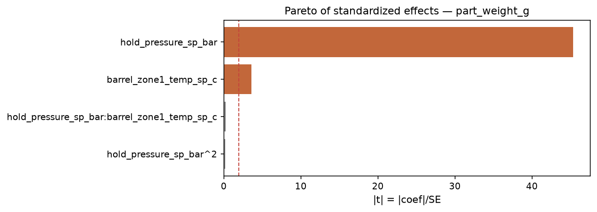
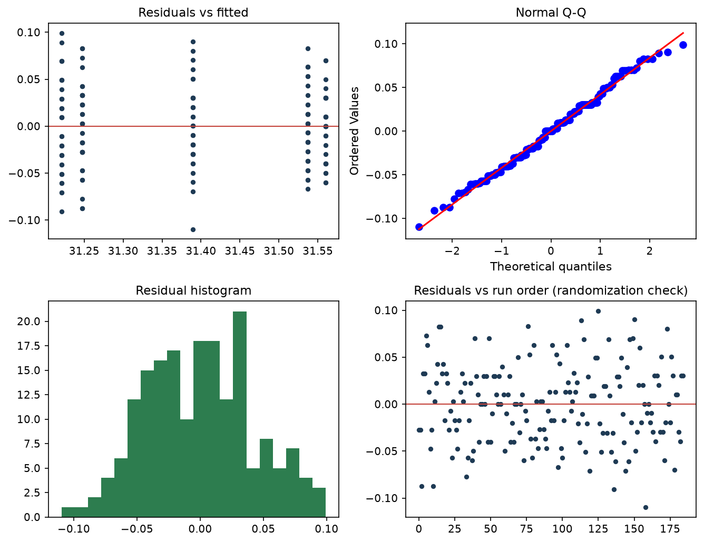
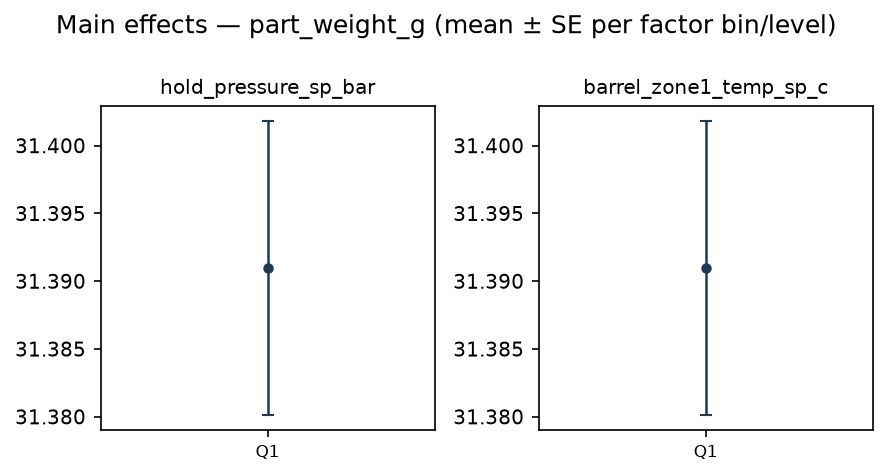
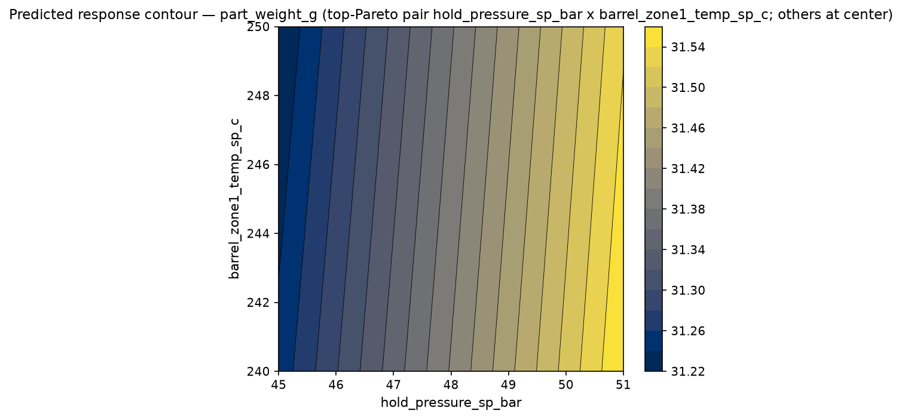
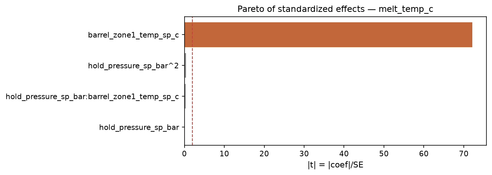
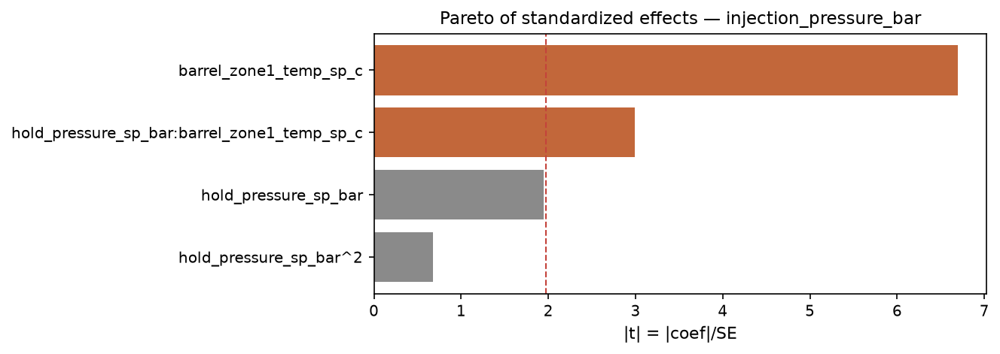

# 数据分析报告 — 202610180227250_offline-data_diag

> 由 industrial-doe-analyzer 生成 · 分析模式 designed · 设计类型 full_factorial ·
> 证据等级 A（条件性，见 3.2） · 下游合同 recommendations.json v1.0
>
> 数据：注塑验收线（模拟4036）· AW 快照 exp-daqexp-20261018102646-fc7c64 ·
> 00_input/doe_table.csv（185 行 = 5 个条件 × 37 个制品）。
> 本报告所有数字取自本次运行的工件（01_profile / 02_analysis / 03_figures / conclusions），
> 统计量由 analyze.py 确定性计算，agent 只做解读，未改动任何计算值。

---

## 一、10 秒结论卡

| 项 | 值 |
|---|---|
| 关键因子（按效应强度） | ① 保压压力 SP（A）→ 制品重量，Pareto 第 1，partial η²=0.919；② 机筒一区温度 SP（B）→ 熔体温度 PV，Pareto 第 1，partial η²=0.967；③ 交互 A×B → 注射压力 PV，Pareto 第 2，partial η²=0.047 |
| 推荐操作窗口数 | 2（其中 0 条需先做确认试验；2 条均为方向性窗口、均含设计边界外推端点） |
| 预期收益（最优窗口） | 制品重量（主目标）：A 由 48 bar → 50.25–51.0 bar，按 +0.05241 g/bar 线性效应预期 +0.118～+0.157 g（相对基线 31.39 g 约 +0.38%～+0.50%，未做确认试验） |
| 证据等级 | A（0 项清单失败；但 `randomization_ok=true` 属自动检查盲区——顺序试验未被识别为未随机化；`model_adequacy_ok` 不可评，失拟检验不可估） |
| 最重要的限制 | 每个条件只运行一次、37 个制品为重复测量（伪重复），p/q 与 MDE 全部偏乐观；且运行顺序未随机化，效应可能混入时间漂移 |

**一句话结论**：制品重量由**保压压力 SP（A）**主导——编码系数 +0.15723（+0.05241 g/bar，45→51 bar 全摆幅约 +0.314 g，占均值 31.39 g 的约 1.0%，BH q=9.04×10⁻¹⁰⁰）；机筒一区温度 SP（B）对重量的全摆幅效应只有约 −0.025 g（约 0.08%，且其效应量 0.012365 低于本族 MDE=0.017482 g）；A×B 对重量完全不显著（q=0.841），曲率不显著（q=0.841，且 A² 与 B² 共线、不可归因于单因子）；**最优工况 = 保压压力 SP 提到 50.25–51.0 bar（51 bar 是设计边界，属外推，需工艺确认），温度 SP 保持在 240–250 ℃ 内按其自身约束取定**。成型周期恒为 15.3 s（零方差），本数据**无法提供效率代价**，权衡只能是单目标（质量）推荐 + 待验证的效率假设。

---

## 二、1 分钟证据层

### 2.1 效应/相关排序（effect_table.json 全量；q<0.05 加粗）

**响应 1：制品重量 part_weight_g（主目标，goal=maximize，weight=1.0，单位 g）**
模型：R²=0.919876，adj-R²=0.918095，Q²(LOO)=0.915362，σ(pure error)=0.042208 g，df_resid=180，df_pure_error=180，**MDE=0.017482 g**（2 水平编码主效应口径，即全摆幅 2×编码系数）。

| term | 编码系数 | SE | 原始单位换算 | partial η² | BH q | Pareto | 判读 |
|---|---:|---:|---|---:|---:|---:|---|
| hold_pressure_sp_bar (A) | **+0.15723** | 0.003469 | **+0.05241 g/bar**；全摆幅 45→51 bar ≈ **+0.314 g**（≈均值 1.0%） | **0.919416** | **9.04×10⁻¹⁰⁰** | 1 | 显著且工程量大：唯一可用于调重的因子 |
| barrel_zone1_temp_sp_c (B) | **−0.012365** | 0.003469 | −0.002473 g/℃；全摆幅 240→250 ℃ ≈ **−0.025 g**（≈均值 0.08%） | 0.065912 | **9.36×10⁻⁴** | 2 | 统计显著但工程可忽略；且 |效应| 0.012365 < MDE 0.017482，显著性来自 σ 低估（伪重复） |
| hold_pressure_sp_bar:barrel_zone1_temp_sp_c | +0.000878 | 0.003469 | 编码单位（coded×coded），非物理单位 | 0.000356 | 0.841 | 3 | 不显著：重量可按主效应可加处理 |
| hold_pressure_sp_bar^2 | +0.001554 | 0.007758 | 编码单位² | 0.000223 | 0.841 | 4 | 不显著：未检出曲率（且该行是“总体曲率”列，见 3.2） |

**响应 2：熔体温度 PV melt_temp_c（goal 未设，weight=0.001，单位 ℃）**
模型：R²=0.966543，adj-R²=0.965799，Q²(LOO)=0.964658，σ(pure error)=0.227151 ℃，**MDE=0.094086 ℃**。

| term | 编码系数 | SE | 原始单位换算 | partial η² | BH q | Pareto | 判读 |
|---|---:|---:|---|---:|---:|---:|---|
| barrel_zone1_temp_sp_c (B) | **+1.346397** | 0.018672 | **+0.269279 ℃/℃**；全摆幅 ≈ **+2.69 ℃**（≈均值 1.1%） | **0.966541** | **3.89×10⁻¹³⁴** | 1 | 近乎完全由 B 决定（设定值杠杆） |
| hold_pressure_sp_bar^2 | +0.017796 | 0.041751 | 编码单位² | 0.001008 | 0.957 | 2 | 不显著 |
| hold_pressure_sp_bar:barrel_zone1_temp_sp_c | +0.006757 | 0.018672 | 编码单位 | 0.000727 | 0.957 | 3 | 不显著 |
| hold_pressure_sp_bar (A) | −0.000228 | 0.018672 | −0.000076 ℃/bar | 0.000001 | 0.990 | 4 | 不显著：保压压力不改变熔体温度 |

**响应 3：注射压力 PV injection_pressure_bar（goal 未设，weight=0.001，单位 bar）**
模型：R²=0.243664，adj-R²=0.226856，Q²(LOO)=0.201062，σ(pure error)=0.527375 bar，**MDE=0.218438 bar**。

| term | 编码系数 | SE | 原始单位换算 | partial η² | BH q | Pareto | 判读 |
|---|---:|---:|---|---:|---:|---:|---|
| barrel_zone1_temp_sp_c (B) | **−0.290091** | 0.043350 | **−0.058018 bar/℃**；全摆幅 ≈ −0.58 bar（≈均值 1.1%） | **0.199219** | **1.08×10⁻⁹** | 1 | 显著负向：升温降黏、所需注射压力下降 |
| hold_pressure_sp_bar:barrel_zone1_temp_sp_c | **−0.129728** | 0.043350 | 编码单位 | **0.047395** | **6.31×10⁻³** | 2 | **显著交互**（但 0.1297 < MDE 0.2184，见 3.2） |
| hold_pressure_sp_bar (A) | −0.084461 | 0.043350 | −0.028154 bar/bar | 0.020654 | 0.0706 | 3 | 未过 BH q<0.05：仅趋势 |
| hold_pressure_sp_bar^2 | +0.065542 | 0.096933 | 编码单位² | 0.002533 | 0.4998 | 4 | 不显著 |

多重检验：BH-FDR，3 个响应族、12 个检验、**q<0.05 共 5 个**、被剔除出族 0 个。

**回答用户问题（主效应 / 交互 / 显著性）**：
- **主效应**：A 对重量是唯一工程量级的主效应；B 对熔体温度几乎是唯一决定项；B 对注射压力为中等负向；**A 对注射压力未达 BH 显著（q=0.0706）**。
- **交互效应**：只有 **A×B 对注射压力**显著（q=6.31×10⁻³，partial η²=0.047）；对制品重量（q=0.841）与熔体温度（q=0.957）都不显著 → 质量目标可以按可加模型读，无需为交互设窗。
- **曲率**：所有三个响应上唯一可估的二次项（A²，代表角点相对中心点的总体曲率）都不显著（q=0.841 / 0.957 / 0.4998）→ 在 45–51 bar × 240–250 ℃ 盒内，响应基本线性，最优解必然落在盒边界（与 3.1 驻点全部落在设计域外/鞍点一致）。

### 2.2 关键图

图 1 · 制品重量 Pareto（|t| 标准化效应）

图 2 · 制品重量残差诊断（残差-拟合、QQ、尺度-位置、杠杆/Cook's D）

图 3 · 制品重量主效应（A 的斜率远大于 B）

图 4 · 制品重量预测等值线（A × B）

图 5 · 熔体温度 Pareto（B 压倒性第 1）

图 6 · 注射压力 Pareto（B 第 1、交互 A×B 第 2）

（另有两张残差诊断图 `residuals_melt_temp_c.png`、`residuals_injection_pressure_bar.png`，8 张图全部通过 ink gate，见 03_figures/plot_manifest.json。）

### 2.3 稳定性/能力（观察档适用）

本运行为 designed 模式，无 stability_report.json / 能力指数；**用户未提供规格上下限，Cp/Cpk/Pp/Ppk 均不可计算**。可替代的过程波动信息取自各条件的稳态标准差（00_input/doe_table_build_report.json，每个条件 37 个制品）：制品重量 0.0339–0.0482 g（均值 0.042 g 左右）、熔体温度 0.1719–0.2547 ℃、注射压力 0.3883–0.6162 bar；成型周期在所有样本中恒为 15.3 s（标准差 0.0）。条件内波动远小于 A 的全摆幅效应（0.314 g），这是“A 效应可信”的直观支撑；但注意这些标准差是**同一工况内的重复测量**，不是独立重复的误差。

---

## 三、深读审计层

### 3.1 模型与检验细节（02_analysis/model.json）

| 响应 | n | df_resid | df_pure_error | R² | adj-R² | Q²(LOO) | 失拟检验 | 饱和/合并 |
|---|---:|---:|---:|---:|---:|---:|---|---|
| part_weight_g | 185 | 180 | 180 | 0.919876 | 0.918095 | 0.915362 | 不可估（df_lack_of_fit=0） | 无饱和、无合并项 |
| melt_temp_c | 185 | 180 | 180 | 0.966543 | 0.965799 | 0.964658 | 不可估（df_lack_of_fit=0） | 无饱和、无合并项 |
| injection_pressure_bar | 185 | 180 | 180 | 0.243664 | 0.226856 | 0.201062 | 不可估（df_lack_of_fit=0） | 无饱和、无合并项 |

- **模型设定**：effect/deviation 编码（A 半极差 3 bar，B 半极差 5 ℃，编码到 [−1,1]），主效应 A、B + 交互 A×B + 二次项 A²、B²；其中 **B² 判 `aliased` 未估计**（与 A² 编码列完全重复），实际估计 4 项 + 截距，n_params=5，与 5 个设计支撑点（4 角点 + 1 中心）一一对应 → **残差自由度全部来自条件内重复测量，df_lack_of_fit=0，失拟不可检验**。这是本设计最根本的结构限制：模型形式无法被数据否决。
- **Q² 注意**：hat-matrix LOO Q²，重复（孪生）行会泄漏，脚本标注为“乐观上界”（`q_squared_note`）。
- **残差诊断**：part_weight_g 无 |残差|>3σ 样本、max 杠杆 0.027027（截断 0.054054，0 个超限）、max Cook's D=0.038591（超 4/n 截断）；melt_temp_c 有 1/185 个 |残差|>3σ、max Cook's D=0.058492；injection_pressure_bar 有 2/185 个 |残差|>3σ、max Cook's D=0.087495。低 R² 的注射压力族对这两个离群运行最敏感。
- **驻点分类**：三个响应的驻点全部为 `saddle` 且 `inside_design_region=false`——part_weight_g 编码驻点 (14.077, −228.811)^coded ↔ 原始 (90.23 bar, −899.05 ℃)；melt_temp_c (−199.267, 1049.692)^coded ↔ (−549.80 bar, 5493.46 ℃)；injection_pressure_bar (−2.236, −2.911)^coded ↔ (41.29 bar, 230.45 ℃)。因此最优解只能在盒约束内取边界点（W3/W5），脚本对所有响应都写了 `STATIONARY_POINT_WARNING`。
- **窗口与合意度**：Derringer-Suich 合意度（权重 part_weight_g=1.0、melt_temp_c=0.001、injection_pressure_bar=0.001）在编码盒内 L-BFGS-B 精修，得 D=0.995078、编码 (A=1.0, B=−0.979373) ↔ 原始 (51.0 bar, 240.103136 ℃)。**该 B 值由低权重辅助响应（goal 未设 → 默认 maximize）驱动，不代表温度的工程最优**（见 3.2 与 watchlist `SETPOINT_SECONDARY_DRIVEN`）。

### 3.2 披露与限制（全部保留，不得删除）

脚本自动生成的限制（doe_conclusion.json 原文逐条保留）：

1. 响应 part_weight_g 的最大 Cook's D=0.038591 超过 4/n 截断 — 个别试验点对系数影响过大，删除该点可能改变结论
2. 响应 melt_temp_c 残差诊断：1/185 个样本的残差绝对值超过 3σ — 存在离群运行，建议核对原始记录后复核系数
3. 响应 melt_temp_c 的最大 Cook's D=0.058492 超过 4/n 截断 — 个别试验点对系数影响过大，删除该点可能改变结论
4. 响应 injection_pressure_bar 残差诊断：2/185 个样本的残差绝对值超过 3σ — 存在离群运行，建议核对原始记录后复核系数
5. 响应 injection_pressure_bar 的最大 Cook's D=0.087495 超过 4/n 截断 — 个别试验点对系数影响过大，删除该点可能改变结论

Agent 补充的业务/设计限制（同样原样取自 doe_conclusion.json limitations 6–12）：

6. 用户未提供任何规格上下限(lsl/usl/target):operating_windows 是方向性窗口,不是规格约束窗口,不可据此判定制品合格/超差,也不可换算 Cp/Cpk。
7. 每个条件只执行一次,条件内 37 个制品是同一工况下的重复测量(伪重复):df_pure_error=180 被严重高估,只有 5 个条件(4 角点 + 1 中心)是真正独立的试验单元,因此所有 p/q 与 MDE(part_weight_g 0.017482 g)均为乐观值,真实可检效应应显著大于表中 MDE。
8. 运行顺序固定为 C1→C2→C3→C4→C5,未随机化;01_profile/data_profile.json 的 caveats 为空、未产生 NON_RANDOMIZED 警示——自动检查以 run_order_col=ts_block_start 做 Spearman,而该列是字符串时间戳,无法数值化,检查被跳过。因此 evidence_grade=A 只能视为条件性结论,因子效应仍可能混入时间/批次漂移。
9. 曲率不可分离且失拟不可检验:仅 1 个中心条件,设计只支持 1 个二次项(A² 与 B² 完全共线,B² 判 aliased),df_resid=df_pure_error=180 → df_lack_of_fit=0,失拟检验不可估;模型形式(“单一曲率 + 交互 + 线性”)本身无法被本数据否决。
10. 熔体温度 PV ≠ 机筒温度 SP:PV 在 SP 240 ℃ 下约 246.7 ℃、SP 250 ℃ 下约 249.4 ℃(固定偏移,见 doe_table_build_report.json)。B 只能作为设定值(SP)杠杆解释,不能直接当作熔体实际温度,也不能据此反推其它温度设定下的 PV。
11. 成型周期 cycle_time_s 在全部样本恒为 15.3 s(零方差),任何因子对周期的影响都不可估,因此本实验无法给出效率(周期)代价,最优工况权衡只能是单目标(质量)推荐 + 待验证的效率假设。
12. 合意度默认规则带来的解释风险:melt_temp_c 与 injection_pressure_bar 的 goal 未设、权重 0.001,脚本按 maximize 默认处理,因此 setpoints 中 B≈240.1 ℃ 是低权重辅助响应的盒边界解,不构成温度的工程最优;温度设定应在 [240,250] ℃ 内按工艺约束取定。

**重点解读**（对上述限制的工程含义，不改动任何数字）：

- 限制 7 的实操含义：B 对重量的编码系数 0.012365 小于该族 MDE=0.017482 g，而 q=9.36×10⁻⁴ 仍显著——两者并存只能用“σ 被伪重复低估”解释，所以不要把 B 当调重旋钮；注射压力族同理（交互 0.129728 < MDE 0.218438）。
- 限制 8 的实操含义：等级 A 的 `randomization_ok=true` 是自动检查的盲区（字符串时间戳导致 Spearman 被跳过），执行窗口前应当用随机化重复自行补证。
- 限制 9 的实操含义：既然曲率不可分离且不显著，A 的响应在盒内按线性处理，最优解落在盒边界（50.25–51 bar）是设计结构的必然结果，不是“找到了内部最优点”。
- 限制 10–12 的实操含义：温度只能按 SP 解释、周期没有响应、setpoints 的 B≈240.1 ℃ 不可直接执行——这三条共同决定了本次交付只能是“质量单目标 + 方向性窗口”。

### 3.3 最优工况推荐与权衡（回答用户问题）

**主目标（制品重量 maximize，weight=1.0）**

| 项 | 数值 | 来源 |
|---|---|---|
| 推荐窗口（保压压力 SP） | **[50.25, 51.0] bar**，`shape=disconnected`（只报含最优点的连通块） | recommendations.json OW-002 |
| 窗口性质 | 上端 51 bar **= 设计边界，`extrapolation=true`** → 执行前须工艺确认；禁止再往上外推 | OW-002.extrapolation |
| 单位效应 | +0.05241 g/bar（编码主效应 0.15723 / 半极差 3.0） | OW-002.expected_effect.delta |
| 预期收益 | 48 → 50.25 bar ≈ +0.118 g；48 → 51 bar ≈ +0.157 g（纯线性外推，相对基线 31.39 g 约 +0.38%～+0.50%） | delta × 距离（2.25 / 3.0 bar） |
| 置信 | high（q=9.04×10⁻¹⁰⁰，partial η²=0.919），contract 层面 | OW-002.confidence |
| 温度（B） | 保持 **[240, 250] ℃** 内（OW-001，`extrapolation=true`，服务于低权重 melt_temp_c）；对重量的全摆幅效应仅约 −0.025 g，不构成调重手段 | OW-001 / KF-002 |
| 多响应合意度最优点 | A=51.0 bar、B≈240.1 ℃、D=0.995078（B 由低权重辅助响应驱动，见限制 12） | setpoints[MULTI] |
| 当前基线 | 中心条件 C5：48 bar / 245 ℃，重量均值 31.39 g；距 OW-002 为 2.25 bar，距 OW-001 为 0 | current_baseline |

**权衡说明（为什么这是单目标推荐）**

- **质量 vs 效率**：成型周期恒为 15.3 s（零方差），**没有任何周期响应可供优化**，因此本数据既不能证明“提高保压压力会延长周期”，也不能证明“不会”。权衡在本合同里只能是**单目标（制品重量）**：窗口 A∈[50.25, 51] bar 是质量侧建议；效率侧只有待验证假设（保压压力提高通常增加保压时间占比/锁模力需求，需另做周期敏感试验确认）。
- **质量的边际收益 vs 风险**：A 的效应在盒内近似线性（曲率不显著），因此窗口内部越靠上越好；但 51 bar 触边界、且 50.25 bar 以下即离开可行块——建议先在 50.25 bar 稳态验证，再向 51 bar 试探，避免一次性跳到外推端点。
- **温度侧的权衡**：B 对重量是 −0.002473 g/℃，全摆幅仅 −0.025 g（约 0.08%），工程上可忽略；B 的实质作用是熔体温度（+0.269279 ℃/℃ SP）与注射压力（−0.058018 bar/℃）。若下游以“降低注射压力/能耗”为目标，B 应偏高；若受熔体温度上限或冷却能力约束，B 应偏低——这属于**工艺约束选择**，不由本实验的质量目标决定。
- **窗口性质提醒**：两个窗口都含外推端点（`extrapolation=true`），且都是方向性窗口（无规格带），**不能当作“合格窗口”使用**；contract 的 usage_rules 明确要求外推端点须工艺确认后方可执行。

### 3.4 确认试验计划

recommendations.json 的 `confirmations` 为**空数组**（designed 模式、无 aliased 主效应、无饱和、无显著失拟，脚本未生成强制确认项；两个窗口的 `confirmation_needed=false` 由脚本给出，agent 未改动）。**下游不强制要求确认试验即可执行窗口，但本报告仍建议做一次独立复核**，理由是脚本未覆盖的风险（伪重复、顺序试验）：

1. **区组/随机化重复**：在 48 bar 与 51 bar 两个水平上各做 2–3 次独立运行（每次独立切换工况、随机化先后顺序），确认 A 的 +0.05241 g/bar 斜率是否稳定；这同时补上被静默跳过的 NON_RANDOMIZED 检查。
2. **边界确认**：51 bar 是设计边界（外推），若工艺允许，补一个 52–53 bar 点验证线性是否延续；若不允许，则把 50.25 bar 作为执行上限并留 0.75 bar 余量。
3. **温度设定确认**：在选定 B 下记录熔体温度 PV，核对“PV≈SP+固定偏移”的关系（SP 240 ℃→PV≈246.7 ℃；SP 250 ℃→PV≈249.4 ℃）是否随产量/环境变化。
4. **效率假设确认（本数据缺失项）**：单独采集成型周期（cycle_time_s）与保压时间/冷却时间，验证质量提升是否以周期为代价——当前数据周期恒为 15.3 s，无法回答该问题。

### 3.5 下游使用规则

- 窗口外推端点（extrapolation=true）需工艺确认后方可执行
- 多响应窗口冲突以 conflicts[].chosen 为准

- 适用域：n=185，时间跨度 2026-10-18T01:55:10.942000+00:00 .. 2026-10-18T02:24:15.474000+00:00，工况限定 designed region（A∈[45,51] bar、B∈[240,250] ℃）
- 失效条件：任一因子越出 applicability_domain.factor_observed_ranges 的 ±20%；stability_report 变点检测触发新 regime（漂移/换产）；确认试验结果与 expected_effect 的 CI95 不相交
- watchlist 共 11 条：DISCONNECTED_WINDOW、3×STATIONARY_POINT_WARNING、NO_SPEC_LIMITS、PSEUDO_REPLICATION、RUN_ORDER_NOT_RANDOMIZED、QUADRATIC_NOT_SEPARABLE、CONSTANT_CYCLE_TIME、SETPOINT_SECONDARY_DRIVEN、PV_SP_OFFSET

---

## 附：工件索引

| 工件 | 内容 |
|---|---|
| 00_input/analysis_context.json | 用户给定的响应/因子角色、目标与权重（assigned_by=user） |
| 00_input/doe_table.csv | 185 行分析表（5 条件 × 37 制品，9 列） |
| 00_input/doe_table_build_report.json | 建表溯源：稳态守卫 180 s、逐条件稳态均值/标准差、PV 与 SP 偏移、伪重复声明 |
| 01_profile/data_profile.json | 列角色、设计识别（full_factorial、4 角点 + 37 中心行、balance_ratio=1.0）、检测说明与 caveats（本运行 caveats 为空） |
| 02_analysis/effect_table.json | 3 个响应族的效应、extra-SS ANOVA、η²、BH q、Pareto、MDE |
| 02_analysis/model.json | 编码系数、R²/adj-R²/Q²、失拟、残差诊断、驻点与 Hessian 分类 |
| 03_figures/plot_manifest.json | 8 张图的 ink gate 结果（全部 ink_ok=true） |
| conclusions/doe_conclusion.json | 结论、证据等级与清单、6 条关键发现、12 条限制 |
| conclusions/recommendations.json | 下游合同 v1.0：2 个窗口、1 个合意度设定点、1 条交互、11 条 watchlist、适用域与失效条件 |
| report.html | 由 analyze.py report 确定性渲染的交互版（数字同源，禁止手改） |
