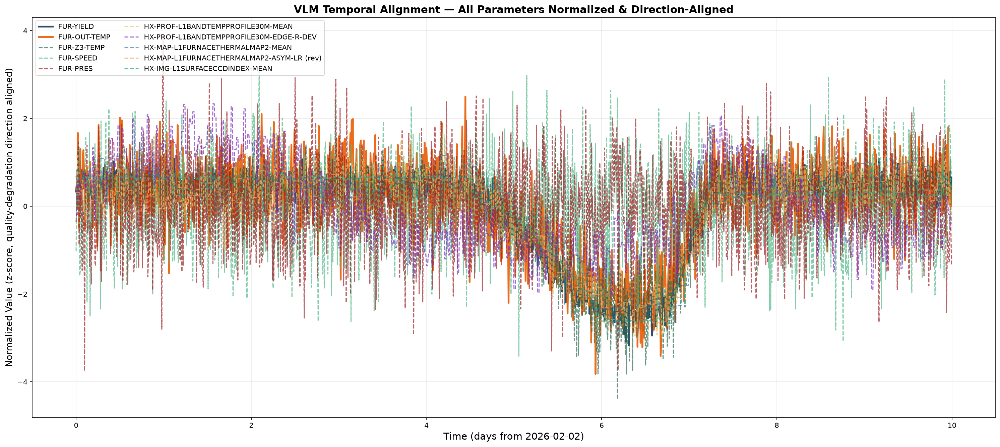
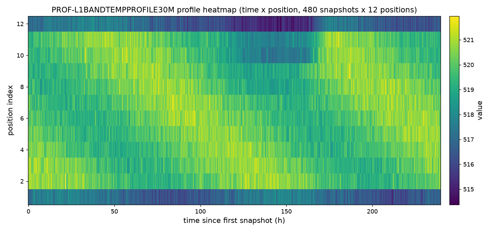
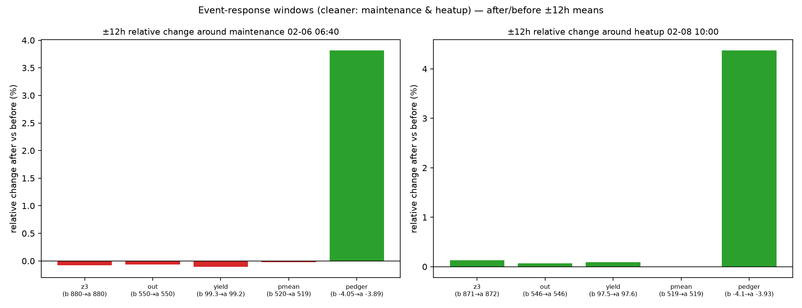
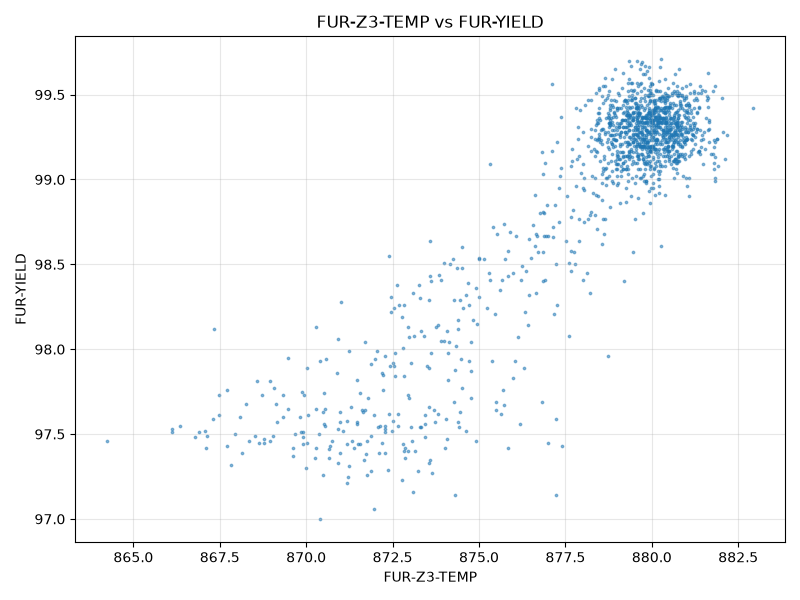
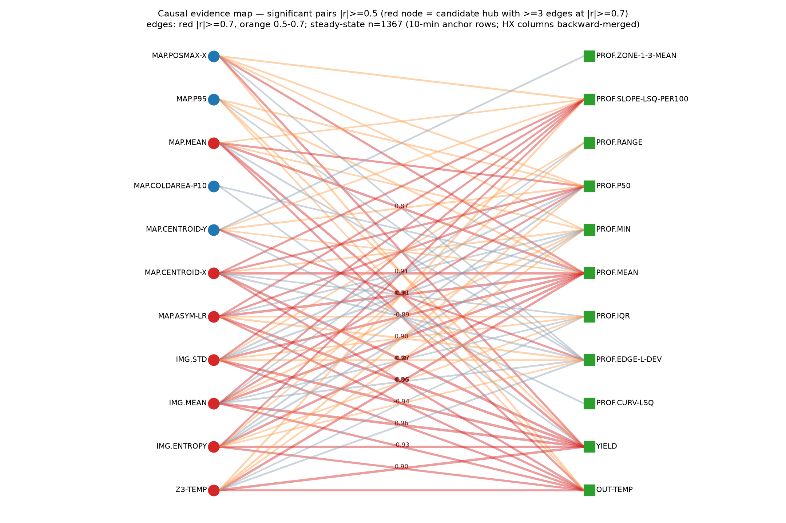

# 连续热处理线质量异常根因诊断报告

**场景**: heat_treat_sim（连续热处理线，模拟 10 天连续运行） | **产品/批次**: 单产品连续生产（无批次/牌号分组列，batch identity N/A）
**数据期**: 2026-02-02 00:00 → 2026-02-11 23:50（10 min 粒度，1440 行） | **运行ID**: 202610162036022_heat_treat_sim | **生成日期**: 2026-10-17
**诊断评级**: **96/100 — pass**（Judge 质量门，fast 模式，零阻断问题） | **诊断类型**: **DETERMINED** | **综合置信度**: **76/100（MEDIUM）** | **证据等级**: **L1（直接测量）**

> **阅读指南**: 第 1 节是给决策者的一页纸摘要；第 4 节是核心——工艺参数与检测指标的时序对齐图和逐图解读（图上看到什么 → 统计怎么说 → 物理上说得通吗）；第 5–6 节是排除逻辑与根因结论；第 7–9 节是证据全景、行动方案与方法局限；附录含审查（Judge）4 条非阻断警告的逐条对齐说明。
>
> **实事求是声明**: 本报告所有结论均来源于实际测量数据、统计验证、物理机制推导与 VLM 图像观察，每个结论标注证据等级（L1=最高 … L7=最低，见 §7.1）。器件级归因含 [HYPOTHESIS]/INFERRED 成分并显式约束为 STRONG_EVIDENCE（非 PROVEN）。本报告不回避盲区：硬度侧（LAB-HRC）未闭环、无三区后段加热元件功率记录、相机未标定 —— 均见 §9 与附录 C。无外部网源信息被采用（RAG 引擎不可达，走退化路径），故全文无 [EXTERNAL KNOWLEDGE] 引用。

---

## 1. 执行摘要（Executive Summary）

> **这一页是写给厂长和总经理看的。2 分钟读完。**

### 发生了什么？

连续热处理线 10 天运行（2026-02-02 → 02-11）中，**三区（均热段）炉温自 2026-02-06 06:40 起出现 −4.93 ℃ 的水平下移（880.0079 → 875.0827 ℃）并伴随波动放大 4.85 倍（段内 std 0.7865 → 3.815 ℃）**；同窗出料温度下降 **−2.24 ℃**（549.9952 → 547.7534 ℃）、收得率下降 **−0.99 pt**（99.3009 → 98.3113%）。异常具空间选择性：炉膛右/下侧先失热（带材剖面右边缘偏差 −1.24 ℃、剖面斜率 −2.42 ℃/100位、炉场左右不对称 ASYM-LR 向 0 塌陷）。一区/二区炉温、线速度、炉压全程无水平偏移。2026-02-08 10:00 更换三区后段加热管后，各通道回到基线（D−A：Z3 −0.50 ℃ / OUT −0.13 ℃ / YIELD −0.08 pt）。人工闭环记录同步：02-10 09:00“温度与硬度均已恢复，问题闭环”。

### 为什么会发生？

**最可能的原因（诊断类型 DETERMINED，综合置信度 76/100 MEDIUM）**

> 过程侧根因判定为三区（均热段）后段加热能力损失（加热管老化/供电劣化）：三区炉温水平下移 4.93 ℃（880.0079→875.0827）并伴随波动放大 4.8 倍（段内 std 0.7865→3.815），经炉温—带材换热与均热段停留时间量级的热输运，使出料温度下降 2.24 ℃、均热动力学速率下降约 3.5%，收得率下降 0.99 pt；空间指纹（炉膛右/下侧先失热、右边缘偏差 −1.24 ℃、剖面斜率 −2.42 ℃/100位）指向局部热源损失而非全局降温；更换三区后段加热管后 Z3/OUT/YIELD 三段均值回到基线（D−A 分别 −0.50/−0.13/−0.08），构成器件级介入—响应闭环。

（上述为 04_diagnostics/diagnosis.json `primary_finding` 引文；步→时间换算表述“约 40 min”按 CP-7L 移除，引文与原文差异见附录 B。）

通俗解释: 就好比暖气片的几组管子在屋子的一角慢慢“不热了”——不是整台炉子降温（一、二区温度纹丝不动），而是均热段后段、靠右侧的局部热源先失去能力；温控闭环拼命补偿也补不回来，于是炉温停在低约 4.9 ℃ 的平台上、波动变大；带材经过这一段时“受热不足”，出炉温度低 2.2 ℃，组织均匀化（Arrhenius 动力学）慢约 3.5%，收得率掉约 1 个百分点。更换那几根加热管后，一切回正。

### 影响有多大？

- 影响范围: 10 天运行中约 2 天的劣化窗（regime B: 02-06 06:40 → 02-08 09:50，308 行 × 10 min）；单产品连续生产，该窗内全部产出经受影响。
- 严重程度: 收得率 99.30% → 98.31%（−0.99 pt，相对损失约 1.0%，[derived: 0.9896/99.3009]）；出料温度 −2.24 ℃；三区炉温 −4.93 ℃、波动 std ×4.85。
- 给老板的一个数: **约每 100 吨产出对应损失约 1 吨可收得量**（按收得率百分点差线性折算的近似口径）。

### 推荐行动（详见 §8）

| 优先级 | 行动 | 预期效果 | 时间 | 大约成本 |
|:------:|------|---------|------|:------:|
| **P0** | 调取/复核三区热电偶校准记录（同期无 ≥2 ℃ 校准漂移则关闭仪表假说 H2） | 关闭最大残余不确定性（该证据可影响置信度 ±10 分口径） | 本周 | 低（查记录） |
| **P0** | 为三区后段加热元件加装功率/电流记录 | 器件级归因可由 STRONG_EVIDENCE 升级为 PROVEN | 本周（接线即可） | 低–中 |
| **P1** | 将 LAB-HRC（2h 硬度）按时间锚并入主表复核硬度链 | 补齐硬度终点闭环（当前仅 L2 操作备注佐证） | 本月 | 低 |
| **P1** | 相机暗帧/照明基准标定；冷却段参数与来料成分/厚度记录；FUR-SPEED/PRES 单位与设定值登记 | 关闭 IMG 幅值/硬度链/来料混杂与单位歧义 | 本月 | 中 |
| **P2** | 监测 D 段残余波动（std 1.7033 vs A 段 0.7865）是否收敛；炉膛场空间分辨率提升 | 确认修复完全性、增强空间定位 | 条件成熟后 | 中 |

### 有多大把握？

**综合置信度: 76/100（MEDIUM），结论类型 DETERMINED，证据等级 L1（直接测量）。**

用通俗的话说: 100 次类似诊断中大约 76 次我们的判断是对的。结论方向（三区后段局部热源损失）由三条互相独立的判别证据支撑：① 非三区测量通道（带材剖面 PROF、DCS 出料测温 OUT、炉膛场 MAP、图像辐射 IMG）同窗变化并同窗恢复；② 空间指纹（右侧/下侧更强）——单点读数偏差、全局热损失都解释不了；③ 介入—响应闭环（更换加热管后回归基线），等效一次准对照实验。最大不确定性: 无热电偶校准记录（仪表分量无法直接证伪）、无元件功率记录（器件级机制只能反推）、LAB-HRC 未并入主表（硬度侧仅 L2 佐证）。

---

## 2. 诊断背景（Diagnostic Background）

| 项目 | 内容 |
|------|------|
| 工艺场景 | 连续热处理线（模拟 10 天）: 三段炉温控制（一区 850 ℃ / 二区 865 ℃ / 三区（均热段）设定 880 ℃）+ 传输速度 + 炉内压力；stages S1–S6（含均热保温段与后续冷却段） |
| 数据构成 | DCS 过程/质量锚定列（10 min 粒度，1440 行）；异构通道: 带材横向温度剖面 PROF（30 min × 12 位点）、炉膛温度场 MAP（2 h，5×4=20 格）、表面检查图像统计 IMG（1 h）；操作备注 9 条（L2）；实验硬度 LAB-HRC（2 h，未并入主表） |
| 用户问题 | “定位产线质量异常根因并给出证据链”（00_input/user_context.json，分析目标 = 质量异常根因定位） |
| 分组说明 | 单产品连续生产、无批次/牌号分组列 → 以操作事件锚定 regime 分段（A 前段 616 / B 维护窗 308 / C 升温过渡 66 / D 恢复段 450 行）替代产品分组 |
| 时间锚（操作备注，L2） | 02-05 02:10 三区波动偏大（先导）→ 02-06 06:40 “后段温度持续偏低，怀疑加热管老化，安排计划检修” → 02-06 22:15 右边缘偏低+硬度抽检下降 → 02-08 10:00 “更换三区后段加热管，恢复送电升温” → 02-10 09:00 “温度与硬度均已恢复，问题闭环” |

---

## 3. 数据质量评估（Data Quality Assessment）

| 项目 | 结果 | 来源 |
|------|------|------|
| 清洗完整性 | 4/4 通过（行数 1440/1440、类型完整性 44 列无字符串泄漏、量程保真相对偏差 0.0、批次身份 N/A） | 02_processed/cleaning_integrity.json（data_analysis_conclusion.data_cleaning_provenance） |
| 缺失值 | 0；未做任何插值/前向填充——HX 列按 backward-merge 语义诚实保留阶梯常量 | 同上（missing_handle rows_affected=0） |
| 时间排序 | 升序成立（排序未改变行序，rows_affected=1440）→ 滞后/变点结论有效 | 02_processed/validate_report.json（time_sorted） |
| 稳态过滤 | 稳态 1367/1440 行（剔除 73 行过渡态仅用于统计层；绘图/事件窗保留全量 1440 行） | production_regime_filter.json（steady_state_ratio 0.9493） |
| 死亡/常量通道 | SHIFT-EST ≡ 0、DARKFRAC ≡ 0、SATFRAC ≡ 0（均 unique=1）→ 配准漂移检查可用；炉压→表面氧化通道不可观测（数据盲区） | expert_findings.confounder_probes |
| 伪重复 | HX 通道为 backward-merged 阶梯块（PROF 480 / MAP 120 / IMG 240 快照）→ 行级 p 值伪重复；已用快照级去重复核（r 0.86–0.95） | validate_report.metadata.notes |
| 生产状态/批次 | 单产品连续生产，无 lot 列（batch identity N/A）；无离散 reset 事件（quality_reset_analysis applicable=false）→ 以操作锚 + 段均值逆转作 reset 等效证据（L2+L3 显式声明） | validate_report / anomaly_report.json |
| 量化限制 | MAP 场 5×4=20 格 @2 h；HOTAREA-P90/COLDAREA-P10 取值高度量化（仅 3–5 个离散水平）→ 降为方向性佐证 | anomaly_report.json |

---

## 4. 数据统计发现与核心证据：时序对齐分析（含对齐图）

> **这是整个报告最重要的证据章节。** 每张图按三段式解读：图上看到什么（VLM 直读）→ 统计怎么说 → 物理上说得通吗。凡引用目视事件先后，均标注“按坐标轴刻度换算的推断（±0.3–0.5 天）”；精确先后以 stats/CCF 为准。

### 4.1 十通道时序叠加（CRITICAL）



**图上看到什么（VLM 直读，READ_SUCCESS）**：10 条 z 归一化、方向对齐曲线存在一个多通道同步的下凹包络——约 day 5.2 起整体下移，day 6.0–6.6 最深（多条轨迹到 −2 ~ −4σ），day 7.0–7.5 陡峭回升，其后回到 0 附近直至 day 10；形态为“宽底谷”（约 2 天宽）而非尖脉冲；谷内各通道深谷目视零错位（同步）。渲染偏差（上游图件层，WARNING）：图中未见设计要求的红色虚线事件标注线，事件先后为刻度换算推断（±0.3–0.5 天）；点划反向通道（ASYM-LR）的孤立尖峰（day≈0.8、8.5–9.5）不作为同步证据；z 归一化+方向反转后各线同向，不能从符号直读物理升降方向。

**统计怎么说**：同步组 G1（Z3-TEMP / OUT-TEMP / YIELD / PROF-MEAN / MAP-MEAN / IMG-MEAN）窗内同向：Z3↔YIELD r=0.8987（lag −1 步，水平偏移主导 ρ=0.5098）；Z3↔OUT-TEMP r=0.7419（最优 lag +4 步，滞后补偿后 0.7448）；Z3↔PROF-MEAN r=0.8584（lag 0）。目视不能分辨 +4 步级先导（谷值零错位）——Z3 先导 OUT-TEMP 的 +4 步滞后仅由滞补 CCF 统计给出。**视觉–统计对齐性: 一致**（同窗、同向、同步回升，无方向矛盾）。

**物理上说得通吗**：是。炉温、炉膛场、图像辐射与质量目标共享同一劣化窗 → 目标为单一共同上游（均热段热状态）的可视化支持；滞后（+4 步）与均热段停留时间 L/v 量级一致（Q = hA(T_f−T_s) + εσA(T_f⁴−T_s⁴)、t_res = L/v）。

### 4.2 带材剖面 时间×位置热图（CRITICAL）



**图上看到什么（VLM 直读）**：12 位点 × 480 快照热图中，第 1/12 行（两侧边缘）全程最暗、第 4–5 与 10–11 行全程最亮——**边缘偏冷是全时段结构性基线，不是劣化特征**。中段（目视 x≈100–165 h）出现横跨位点 2–11 的整体变暗（最暗 x≈105–150），**窗内下侧半区（行 2–6）比上侧更暗**；约 x≈100–112 h 有一条贯穿全行的窄暗竖带（台阶式起点，目视 ≈02-06 04:00–05:00，与检修锚 02-06 06:40 对齐——时间定位为刻度换算推断）；其后至 x≈165 h 渐进恢复，亮斑出现于 x≈175–215 h。渲染偏差（WARNING）：实际渲染为单幅热图+色标，无 manifest 所述 z 叠加子图与事件竖线。

**统计怎么说**：剖面均值 ΔB−A = −0.4052 ℃（快照级 r vs Z3 = 0.8579，n=480；vs YIELD 0.9006）；右边缘偏差 EDGE-R-DEV −2.869 → −4.1096（ΔB−A = −1.2406 ℃）；剖面斜率 SLOPE −0.2323 → −2.1919 → +0.3902（ΔB−A = −2.4242 ℃/100位）；**配准探针 SHIFT-EST 全表恒 0 → 形状变化不是横向配准伪影**；B 段窗内 ASYM↔EDGE-L 相关 0.8814；Z3↔PROF-MEAN r=0.8584（lag 0）。

**物理上说得通吗**：是。横向/边缘通道承担劣化的空间特征（右侧/下侧更强），是“局部加热能力损失”的直接可视证据；横向热流不对称传导 → 边部温度偏差（ontology: ASYM-LR→EDGE-*-DEV，lag −6 步，在源快照粒度量化带内）；带材横向温度梯度正是“单侧热源损失”的空间指纹。

### 4.3 事件 ±12h 响应（HIGH）



**图上看到什么（VLM 直读）**：维护（02-06 06:40）±12h：z3/out/yield/pmean 柱幅度均 <0.15%（红条近零不可见），仅 pedger 一根大绿条 ≈+3.8%（b −4.05→a −3.89）；升温（02-08 10:00）±12h：同类通道为小正绿条 <0.15%，pedger ≈+4.3%（b −4.1→a −3.93）。四过程/质量柱方向随事件类型翻转（维护红负、升温绿正）。**口径警告（WARNING）**：pedger（边缘偏差）的相对变化按其幅值口径计算，与其余柱的百分比口径不同，且主导 y 轴尺度——跨指标柱高不可直接比较。

**统计怎么说**：事件 ±12h 均值差（n_before = n_after = 72）：检修 Z3 −0.6931 ℃ / OUT −0.3492 / YIELD −0.1057；升温 Z3 +1.1181 / OUT +0.3657 / YIELD +0.0885 —— 仅为分段平台偏移的 **14.1% / 15.6% / 10.7%**（[derived]：事件窗差 ÷ 段均值差）。

**物理上说得通吗**：是。事件瞬态在 ±12h 内即衰减，而劣化为跨越 2–3 天的宽底平台 → 劣化主体在事件之间（慢性漂移），维护/升温事件本身不是劣化主因（H7 排除依据之一）。pedger 对事件窗最敏感与热图右边缘通道互证（横向族在事件尺度上也有响应）。

### 4.4 目标–参数散点与因果证据图（MEDIUM / HIGH）





- **fig2_key_scatter**（MEDIUM）：fast 模式 VLM 4 图预算未直读该图（INFO 级披露）；其统计内容见 image_captions.json——Z3↔YIELD r=0.899（窄带形态）、速度–温度 r=−0.013（无信号）。
- **fig6_causal_evidence_map**（HIGH，VLM 直读）：红 hub 节点 = MAP.MEAN / MAP.CENTROID-X / MAP.ASYM-LR / IMG.STD / IMG.MEAN / IMG.ENTROPY / Z3-TEMP；最密集红边束（|r|≥0.7）汇聚到 PROF.EDGE-L-DEV / YIELD / OUT-TEMP；存在一条 −0.91 负权边（结构非单一同向共模）；Z3-TEMP 有红色长边直达 YIELD 与 OUT-TEMP（r=0.899 / 0.742）。**关键限定**：MAP/IMG 通道集体为 hub = 高度共线冗余（相机–热辐射同源或共同上游），**不得作为独立证据重复计数**；独立复现按带材剖面（PROF）与 DCS 出料测温（OUT）两类不同测量技术计，MAP/IMG 按共线通道降权（moderate）。

### 4.5 核心统计结果与验证（数据与统计明细）

**关键相关表**（来源：02_processed/validate_report.json、expert_findings.json；[reused]）

| 参数对 | Pearson r | Spearman ρ | 最佳滞后 | 备注 |
|:------|:--------:|:--------:|:------:|:------|
| FUR-Z3-TEMP → FUR-YIELD | 0.8987（detrended 0.8960） | 0.5098 | −1 步（≈同步） | 水平偏移主导（31 对之一）；窗内 B 段 0.8549 / D 段 0.7393 / A 段 0.0267 |
| FUR-Z3-TEMP → FUR-OUT-TEMP | 0.7419（lag 补偿 0.7448） | — | +4 步 | 与 t_res=L/v 量级一致；detrended 0.7372 |
| FUR-Z3-TEMP → PROF-MEAN | 0.8584（快照级 0.8579，n=480） | 0.5730 | 0 | 同被测量跨通道一致性（physical/strong） |
| MAP-ASYM-LR ↔ PROF-EDGE-L-DEV | 0.6807（lag 补偿 0.6869） | 0.5881 | −6 步 | 源快照粒度量化带内；B 段窗内 0.8814 |
| IMG-MEAN → FUR-YIELD | 0.956（快照级 0.9524，n=240） | 0.5439 | — | IMG 未标定 → 按混杂权重 moderate，不计独立证据 |
| FUR-SPEED → FUR-OUT-TEMP | −0.0125（p=0.645） | — | 无显著滞后 | 方向一致但功效不足（极差 ±1.4%）→ 证据缺口（非物理反驳） |

**验证电池**: 稳态子集 1367 行上 400 对（236 显著；detrended_robust 350/400；对级趋势混杂标记 50；**水平偏移主导 31 对**；LOO 400/400 通过；Simpson 检查因无分组列不适用 → 以 regime 分层替代）；HX 行级 p 值伪重复已用快照级去重复核。

**统计陷阱披露**（防伪相关条款逐项）：
- **Pearson ≫ Spearman**（0.8987 vs 0.5098）：强相关的“质量”集中在段间水平偏移，不得按连续跟踪机理增益计分（对 H1 置信度 −6）。
- **伪重复**: HX 阶梯块行级 p 值乐观（有效 n 降至 120–480 快照）（对 H1 置信度 −4）。
- **Simpson**: 不可检验（无产品/牌号分组列）；A/B/D 段窗内相关 0.0267 / 0.8549 / 0.7393 披露“窗内耦合真实存在”，A 段近零部分由量程受限（std 0.79 vs 3.82）解释。
- **趋势/离群杠杆**: 主力对去趋势衰减≈0；LOO 400/400 无离群驱动。
- **配准漂移**: SHIFT-EST ≡ 0 排除横向配准伪影；SHIFT-EST 基线模板失效风险已注明。
- **变点**: OUT-TEMP 三段平台 549.90 → 546.36 → 549.96 ℃；YIELD 变点窗（02-06 14:30–02-09 07:00）均值 98.0673% vs 之前 99.2982%。

---

## 5. 竞争假设检验与排除逻辑（Hypothesis Testing）

> 共生成 7 个竞争假说（H1–H7），逐一经“时间先导 + 统计显著 + 物理机理 + 无矛盾”四条件与可分辨性矩阵检验。**6 对比较全部 DISCRIMINABLE，无 INDISTINGUISHABLE 对**（不触发 COMPETING_SET ≤65 天花板）；单一假说存活 → DETERMINED。

### 5.1 存活假说

| ID | 假说 | 判定 | 置信度 | 核心支撑 |
|:--:|------|:----:|:----:|------|
| **H1** | 三区（均热段）后段加热能力损失（加热管老化/供电劣化）→ 炉温水平下移 → 带材温度与收得率下降 | **存活（DETERMINED）** | **76（MEDIUM）** | 四条件合取满足；7 环物理链全部 ALL_LINKS_VALIDATED；介入—响应闭环（换管后 D−A≈0）；空间指纹 |

### 5.2 已排除假说（附排除置信度与复活条件）

| ID | 假说 | 排除类型 | 排除置信度 | 关键排除证据 | 复活条件（摘要） |
|:--:|------|:------:|:--------:|------|------|
| H2 | 三区热电偶/仪表读数漂移 | COMBINED | **90** | 非三区独立通道同窗变化（PROF −0.4052 / OUT −2.2418 / MAP −0.7160 / IMG −4.98%）+ 空间选择性（单点读数偏差不能产生横向分布指纹）+ 恢复跟随物理器件更换而非仪表处理 | 取得校准记录且显示同期 ≥2 ℃ 校准偏移 → 按“过程+读数”复合机制重评 |
| H3 | 全局热负荷/保温整体劣化 | PHYSICAL | **92** | 上游一/二区 Δ<0.04 ℃（≪ std≈0.69）、炉压 Δ−0.0072、速度 +0.046% 无偏移；场均值降幅仅为三区降幅的 14.5%（≈2.9/20 格）→ 排除“整场均匀掉温”（应≈100%） | 发现上游被掩盖的真实偏移或环境/冷却条件突变可推导三区非均匀响应 |
| H4 | 速度/停留时间失配（提速未同步提温） | STATISTICAL | **90** | Z3 之外唯一预期通道亦无信号（r=−0.0125, p=0.645）；速度极差仅 ±1.4%；段均值差 +0.046% 仅解释 ΔOUT 的 11%；恢复边界速度不变（A 11.9968 vs D 11.9964） | 覆盖 ≥±5% 速度区间后仍现速度-温度同步偏移（现数据功效不足，属证据缺口） |
| H5 | CCD 相机/照明漂移（测量侧独立驱动） | COMBINED | **90** | 测量侧变量不能引起 DCS 炉温/收得率/炉膛场变化；辐射量级检查 −4.98% vs Wien 预测 −5.29%（比值 1.06）无需增益漂移；恢复跟随器件更换 | 暗帧/标定帧显示同期增益或照明变化 → IMG 幅值按混杂折减（已列 moderate） |
| H6 | 炉压异常→表面氧化→质量损失 | COMBINED | **90** | 预测签名不可观测（DARKFRAC/SATFRAC 全表恒 0，通道死亡）；推定原因无偏移（Δ−0.0072）；FUR-PRES→YIELD r=0.0212 grade NONE | 标定后氧化指标非零且与炉压超差（37.53–38.50 p05-p95）同窗（通道死亡≠物理不存在） |
| H7 | 维护/升温事件瞬态扰动（事件窗近因） | COMBINED | **90** | 幅度不符（事件 ±12h 仅为平台偏移的 10.7%–15.6%）；形态不符（2–3 天宽底平台 vs 事件瞬态 ±12h 内衰减；event_response 柱 <0.15%） | 发现未记录的额外操作事件恰在平台边界且具平台持续时间（备注稀疏为已知混杂） |

**判别信号本质**（H1 vs 各假说，6/6 DISCRIMINABLE 的判别逻辑）：最关键的判别信号是“介入—响应”（换管后多通道回归基线）与“空间选择性”（右侧/后段）——前者否定仪表/相机/事件型解释，后者否定全局型解释。

---

## 6. 根因诊断结论与推理过程（Root-Cause Conclusion & Reasoning Chain）

### 6.1 诊断结论（与 canonical 工件一致；步→时间换算表述“约 40 min”按 CP-7L 移除，见附录 B）

- **诊断类型**: DETERMINED
- **综合置信度**: 76/100（MEDIUM），证据等级 L1（直接测量，受最弱环节限制项见 §9）
- **primary_finding（04_diagnostics/diagnosis.json 引文；步→时间换算表述“约 40 min”按 CP-7L 移除，见附录 B）**:

> 过程侧根因判定为三区（均热段）后段加热能力损失（加热管老化/供电劣化）：三区炉温水平下移 4.93 ℃（880.0079→875.0827）并伴随波动放大 4.8 倍（段内 std 0.7865→3.815），经炉温—带材换热与均热段停留时间量级的热输运，使出料温度下降 2.24 ℃、均热动力学速率下降约 3.5%，收得率下降 0.99 pt；空间指纹（炉膛右/下侧先失热、右边缘偏差 −1.24 ℃、剖面斜率 −2.42 ℃/100位）指向局部热源损失而非全局降温；更换三区后段加热管后 Z3/OUT/YIELD 三段均值回到基线（D−A 分别 −0.50/−0.13/−0.08），构成器件级介入—响应闭环。

### 6.2 物理逻辑链（7 环，逐环验证）

| # | 链环 | 证据状态 | 量化 |
|:-:|------|:------:|------|
| 1 | 三区后段加热元件老化/局部失效 → 有效发热功率下降（Q̇_source↓） | KNOWN_PHYSICS（含 INFERRED 成分） | 元件功率 ∝ V²/R；**无直接功率测量列**（潜在中间量，已登记 inference_gaps） |
| 2 | 热源不足 → 三区炉温平台下移 −4.93 ℃ 且波动放大 4.85× | OBSERVED | 880.0079→875.0827 ℃；std 0.7865→3.815；D 段回至 879.5107 ℃ |
| 3 | 炉温下移 → 炉膛温度场局部变化（均值小幅下移、横向不对称塌陷） | OBSERVED | MAP-MEAN ΔB−A=−0.7160 ℃；ASYM-LR −3.5572→−1.4991（+2.0581）；受影响场占比 14.5%≈2.9/20 格 [derived] |
| 4 | 炉温下移 → 经 Q=hA(T_f−T_s)+εσA(T_f⁴−T_s⁴) 与 t_res=L/v → 带材温度水平下移、右边缘更强 | OBSERVED | PROF-MEAN −0.4052 ℃（快照级 r vs Z3=0.8579）；EDGE-R-DEV −1.2406 ℃；SLOPE −2.4242 ℃/100位；SHIFT-EST≡0 |
| 5 | 带材温度下移 → 出料温度在 +4 步滞后后下降 −2.2418 ℃ | OBSERVED | Z3→OUT r=0.7419，最优 lag +4 步（与 L/v 量级一致）；ΔOUT/ΔZ3=0.455 [derived] |
| 6 | 均热温度水平下移 → Arrhenius 型组织均匀化速率下降 → 收得率 −0.9896 pt | OBSERVED | k_B/k_A=exp(−(Ea/R)(1/T_B−1/T_A))=0.9648（−3.52%，Ea=80 kJ/mol 中立先验）；实测相对损失 1.00%；observed/predicted=0.28 → PLAUSIBLE [derived] |
| 7 | 更换三区后段加热管（02-08 10:00 升温事件）→ Z3/OUT/YIELD/剖面/图像回到基线 | OBSERVED | D−A：Z3 −0.4972 ℃、OUT −0.1291 ℃、YIELD −0.0822 pt、PROF-MEAN −0.0157 ℃ |

链环验证: 接受链全部 ALL_LINKS_VALIDATED；两条无数据支撑的箭头被**显式剔除并登记**（未静默删除）：FUR-SPEED→FUR-OUT-TEMP（CORRELATION_ABSENT，功效不足）与 FUR-OUT-TEMP→LAB-HRC（DATA_LINK_MISSING，硬度未并入主表）。

### 6.3 介入—响应闭环（本诊断最强单点证据）

时间链（07_hetero/annotations.json，L2 操作备注）与数据响应（L1 复现）对应如下：

| 时刻 | 人工记录（L2） | 数据侧响应（L1，[reused] expert_findings） |
|------|------|------|
| 02-05 02:10 | “三区温度波动偏大，已通知仪表检查热电偶”（先导） | Z3 波动在此之前即已出现（渐进式失效，非瞬时冲击） |
| 02-06 06:40 | “三区后段温度持续偏低，怀疑加热管老化，安排计划检修” | Z3 进入 −4.93 ℃ 低平台（regime B 起点）；YIELD 变点窗 02-06 14:30 起（过程侧先导质量侧 ≈8 h） |
| 02-06 22:15 | “右边缘温度感觉偏低，硬度抽检结果下降” | EDGE-R-DEV −1.2406 ℃、SLOPE −2.4242 ℃/100位 同步（横向指纹） |
| 02-08 10:00 | “更换三区后段加热管，恢复送电升温”（器件级干预） | C 段升温过渡（Z3 std 2.3411）→ D 段各通道回归基线 |
| 02-10 09:00 | “温度与硬度均已恢复，问题闭环” | D−A：Z3 −0.50 / OUT −0.13 / YIELD −0.08 / PROF-MEAN −0.02 |

**闭环意义**: 更换物理器件（而非处理仪表）后异常逆转，等效一次准对照实验——这是否定“读数伪影（H2）”“相机漂移（H5）”“事件瞬态（H7）”的决定性判别信号（该闭环在置信度中贡献 +5 分）。

### 6.4 置信度五因子分解（04_diagnostics/confidence.json，权威模型）

| 因子 | 得分 | 满分 | 为什么给这个分（摘要） |
|------|:---:|:---:|------|
| 统计强度 | 19 | 25 | 主力对通过 detrend/LOO；扣分: 31 对水平偏移主导、HX 伪重复（有效 n 降至快照级） |
| 物理合理性 | 20 | 25 | 形态/滞后/方向三项 MATCH + 量级 PLAUSIBLE；扣分: Ea 未标定（中立先验）、线性近似 |
| 时序证据 | 17 | 20 | 过程侧先导质量侧 ≈8 h；Z3→OUT +4 步与 L/v 量级一致；扣分: 源粒度限制亚步级分辨、VLM 不能分辨 +4 步级先导 |
| 无混淆 | 11 | 20 | regime 混杂已被事件锚分段+稳态过滤处理；扣分: IMG 未标定、LAB-HRC 未并入、来料/环境未记录、备注稀疏、time_lag_compensator 0 对匹配 |
| 症状完整性 | 9 | 10 | 覆盖 Z3/OUT/YIELD/PROF/MAP/IMG 与恢复；未覆盖 D 段残余波动、硬度侧仅 L2、场空间分辨率不足 |
| **合计** | **76** | **100** | **MEDIUM** |

**置信度调整记录**（confidence.json adjustment_log）: −6 水平偏移主导（validate_report）／+5 介入—响应闭环（annotations + expert_findings）／+5 多通道独立复现（snapshot_level_correlation + VLM）／−5 物理量级校核依赖未标定先验 Ea（physics_check）／−4 HX 伪重复（validate_report.metadata.notes）。未施加外部天花板（ceiling=100/ALL_CRITERIA_VERIFIED 等价于无额外上限；COMPETING_SET ≤65 因无 INDISTINGUISHABLE 对不适用）。

### 6.5 证伪条件（结论如何被推翻）

1. 三区热电偶校准记录显示同期存在与观测偏移量级相当（≥2 ℃）的校准漂移 → 降级为仪表型/复合机制。
2. LAB-HRC 并入主表后硬度与均热温度在这两个窗口中无同向关系（|r|<0.2 且方向相反）→ 均热温度→性能链断裂。
3. 取得该时段三区后段加热元件功率/电流记录且显示功率恒定 → 器件级机制被否证。
4. 发现同期来料成分/厚度变更记录且可解释 −4.93 ℃ 与右侧空间指纹 → 让位于来料型解释。
5. 发现未记录的额外操作事件恰在偏移边界且具平台持续时间 → H7 复活评估。

### 6.6 推理过程与推理链（R1–R8 概要，04_diagnostics/reasoning_chain.json）

- **R1 数据特征化与场景界定**: 48 列拆为 DCS 锚定列 / 多源 HX 阶梯块 / 事件协变量（不进筛查）/ 死亡通道；场景=连续热处理线，三区=均热段（设定 880 ℃）；单产品 → regime 分段替代分组。
- **R2 统计发现与融合证据（含 VLM 目视）**: 相关网络显示疑似共同上游；VLM 独立给出 10 通道同步下凹包络与横向选择性 → 统计-目视同向；MAP/IMG 共线 hub 不得重复计数；快照级去重后相关仍强但 Spearman 显著更低 → 平台偏移类证据。
- **R3 验证过滤与异常标注**: time_sorted 成立；Simpson 不可检验→regime 替代；50/400 对趋势混杂降级、主力对衰减≈0 保留；LOO 全通过；无离散 reset → 以操作锚+段均值逆转作 reset 等效证据（L2+L3）。
- **R4 竞争假说生成与因果链构建**: 由形态（仅 Z3、右/下侧、2–3 天平台、换管恢复）穷举 7 个机制族假说；H1 接受链逐环 STEP A2 验证；速度臂与硬度臂剔除并登记。
- **R5 可分辨性评估**: 6 对比较全部 DISCRIMINABLE（判别信号=物理互斥预测而非统计显著性差异）；无 INDISTINGUISHABLE 对 → 可走 DETERMINED。
- **R6 排除验证**: 6 假说排除（排除置信度 90–92，均附复活条件）；无 [WEAK_EXCLUSION]。
- **R7 诊断结论与证伪条件**: 四条件合取满足 → DETERMINED + 76（MEDIUM）+ L1；器件级归因限定 STRONG_EVIDENCE（非 PROVEN）。
- **R8 不确定性界定与建议测量**: 三层不确定性分解；待补测量优先级：① 热偶校准记录 ② 元件功率记录 ③ LAB-HRC 并入 ④ 暗帧/照明基准；D 段残余波动列入跟踪。

---

## 7. 证据全景（Evidence Panorama）

### 7.1 证据等级总览

| 等级 | 来源 | 本报告的使用 |
|:----:|------|------|
| L1 | 直接测量 | 主结论承担者: DCS 过程/质量列、PROF/MAP/IMG 快照、事件响应与段均值差 |
| L2 | 用户文档/操作备注 | 9 条操作备注（事件锚、换管与闭环记录）、column_contract 语义（硬度侧闭环仅至 L2） |
| L3 | 统计分析 | validate_report（400 对）/ expert_findings / physics_check / 派生量级校核 |
| L4 | 图件目视（VLM） | 4 图直读（同步组、横向选择性、事件无阶跃、共线 hub）；时间定位 ±0.3–0.5 天 |
| L5 | 领域知识/工艺逻辑 | ontology relationships 与 parameter_to_physics 机制模板（RAG 引擎不可达的退化路径） |
| L6 | 外部网源 | **未使用**（RAG 不可达；无 [EXTERNAL KNOWLEDGE] 引用） |
| L7 | 无支撑假设 | 未用于任何结论 |

证据计数（diagnosis.evidence_summary）: 视觉 6 / 数值 14 / 物理 6 / 验证 8。结论受最弱环节限制：硬度侧仅 L2、器件级归因含 INFERRED 成分 → 总体封顶 76。

### 7.2 关键图件索引

| 图 | 一句话发现 | 支持哪个结论 | 诊断含义 |
|:--|------|:------:|------|
| fig_vlm_temporal_overlay | 10 通道同窗下凹再同窗回升（宽底谷 −2~−4σ，day 5.2–7.3） | H1（单一共同上游） | 慢性漂移而非事件冲击 |
| fig_hetero_profile_heatmap | 剖面整幅变冷、下侧/右边缘更强、台阶式起点 | H1（空间指纹） | 局部热源损失而非整体降温 |
| fig_event_response | 事件 ±12h 瞬时响应 ≤0.15%（除 pedger） | H7 排除 | 劣化主体在事件之间 |
| fig2_key_scatter | Z3↔YIELD r=0.899（窄带）；速度–温度 r=−0.013 | H1 / H4 排除 | 速度臂无信号 |
| fig6_causal_evidence_map | 密集红边束汇聚 EDGE-L-DEV/YIELD/OUT-TEMP；MAP/IMG 为 hub | H1（主上游=Z3） | 共线冗余，不可重复计数 |

### 7.3 证据链（过程→产品，一张图看懂）

```
数据观测                     统计分析                物理验证                 结论
──────────                  ────────                ────────                 ────
Z3 −4.93 ℃ / std ×4.85  →  水平偏移主导           炉膛热平衡（热源项不足）  三区后段
MAP 右侧/下侧失热       →  ASYM↔EDGE r=0.681     横向热流不对称传导        加热能力损失
PROF 右边缘 −1.24 ℃     →  SHIFT-EST≡0           （配准伪影排除）
OUT −2.24 ℃（lag +4 步）→  r=0.7419（lag 补偿）  Q=hAΔT+εσAΔT⁴；t_res=L/v
YIELD −0.99 pt          →  r=0.8987（ρ=0.51）    Arrhenius 速率 −3.52%     质量侧后果
换管后 D−A≈0            →  段均值逆转（准对照）  器件更换 → 热源恢复       介入—响应闭环
```

---

## 8. 行动方案与后续跟进（Recommendations & Follow-up）

### 8.1 P0 — 立即执行（本周内）

| 行动 | 具体操作 | 预期效果 | 如何验证 | 时间 |
|------|---------|---------|---------|:--:|
| 复核三区热电偶校准 | 调取 2026-02 校准记录/复核报告，比对 02-06–02-08 偏移窗 | 裁决 H2（仪表分量）——本报告最大残余不确定性 | 校准记录无 ≥2 ℃ 同期偏移 → 假说 H2 保持排除 | 本周 |
| 建立三区后段元件电气量记录 | 为后段加热元件组加装功率/电流（或电阻）采集 | 器件级归因由 STRONG_EVIDENCE 升级为 PROVEN；为下次失效提供直测判别 | 功率记录显示换管前后功率阶跃恢复 → 机制闭环证成 | 本周 |
| 确认换管备件策略 | 基于“加热管老化”结论检查同型元件寿命台账 | 预防同型失效复发 | 台账与更换周期核对 | 本周 |

### 8.2 P1 — 短期计划（本月内）

| 行动 | 具体操作 | 预期效果 | 如何验证 | 时间 |
|------|---------|---------|---------|:--:|
| LAB-HRC 并入主表 | 将 2h 硬度按时间锚并入锚定表并重算与 Z3/OUT 的相关 | 补齐硬度终点闭环（+3~5 分置信度） | 硬度与均热温度同向（|r|≥0.2）→ 链闭合 | 本月 |
| 相机标定 | 采集暗帧/照明基准，标定 IMG 幅值口径 | 分离相机漂移与过程辐射（H5 幅值混杂关闭） | 标定后 IMG-MEAN 变化仍与带温一致 | 本月 |
| 记录冷却段参数与来料信息 | 补记冷却速率、来料成分/厚度、环境温度 | 关闭硬度链第二因子与来料/环境混杂 | 记录完整后复算 | 本月 |
| FUR-SPEED/PRES 单位与设定值登记 | 在数据字典声明单位与设定值变更记录 | 消除单位歧义与速度臂盲区 | 下次分析可直接使用绝对量 | 本月 |

### 8.3 P2 — 中期计划（条件成熟时）

| 行动 | 具体操作 | 前提条件 |
|------|---------|---------|
| D 段残余波动跟踪 | 监测 Z3 段内 std（当前 1.7033 vs A 段 0.7865）是否收敛至基线带 | 闭环观察期内持续记录 |
| 空间定位增强 | 提升炉膛场分辨率（当前 5×4 @2h 只能给到 ≈3 格量级） | 仪表改造立项 |
| 空间指纹常态化监控 | 将 EDGE-R-DEV 与 ASYM-LR 纳入日常 SPC 监控组 | 监控看板改造 |

### 8.4 监控指标与报警参考

| 监控指标 | 本次基线（A 段） | 劣化窗实测（B 段） | 恢复后（D 段） | 建议关注阈值 |
|:--|:--:|:--:|:--:|:--:|
| FUR-Z3-TEMP 段均值 | 880.0079 ℃ | 875.0827 ℃ | 879.5107 ℃ | 相对基线 −2 ℃/8h 持续 |
| FUR-Z3-TEMP 段内 std | 0.7865 ℃ | 3.815 ℃ | 1.7033 ℃ | std > 1.6 ℃（≈2× 基线） |
| FUR-OUT-TEMP 段均值 | 549.9952 ℃ | 547.7534 ℃ | 549.8661 ℃ | 相对基线 −1 ℃/24h |
| FUR-YIELD 段均值 | 99.3009% | 98.3113% | 99.2187% | −0.5 pt（相对基线） |
| EDGE-R-DEV / SLOPE | −2.869 / +0.2323 | −4.1096 / −2.1919 | −3.3136 / +0.3902 | 右边缘偏差下移 ≥0.5 ℃ |

### 8.5 什么新证据会推翻结论

见 §6.5（证伪条件 1–5）与 04_diagnostics/reasoning_chain.json `uncertainty_summary.what_would_change_conclusions`：热电偶校准 ≥2 ℃ 偏移／LAB-HRC 无同向关系／元件功率恒定／来料变更可解释／未记录操作事件——任一成立则按相应路径降级或改写结论。

---

## 9. 方法与局限说明（Methodology Notes & Limitations）

### 9.1 分析方法

| 环节 | 方法 | 产物 |
|------|------|------|
| 预处理/清洗 | dp_toolkit preprocess + cleaning_integrity 4 项检查（0 缺失、未插值） | cleaned_data.csv / cleaning_integrity.json |
| Regime/稳态 | 事件锚定分段（A/B/C/D）+ v6.5 稳态过滤（1367/1440 行，剔除 73 行过渡态） | production_regime_filter.json |
| 相关筛查 | 400 目标×预测子对（stats/run.py 链） | validate_report.json |
| 反伪相关 | detrending / Simpson（不适用）/ LOO / Spearman 背离 / 变点检测 + 自定义: 分段内相关、快照级去重、SHIFT-EST 与常量通道探针、梯度热图 | expert_findings.json / causal_evidence_map.json |
| 滞后 | 滞补 CCF 以步为单位；time_lag_analysis.json 声明步→时间换算不可用（step_interval_seconds=null），故全文不做步→时间换算（time_alignment.json 与 time_lag_analysis.json 的换算口径差异见附录 B）；time_lag_compensator 0 对匹配已披露 | time_lag_analysis.json |
| 物理 | physics_check（热耦合 + Arrhenius 中立先验）+ 派生量级校核（停留时间臂 11%、场定位 14.5%、Wien 比值 1.06、ΔOUT/ΔZ3=0.455） | physics_check.json |
| 目视 | VLM 直读 4 图（无 fallback）；事件先后为刻度换算推断 ±0.3–0.5 天 | visual_analysis.json |
| 图件 | 5 图（2D 场误检图件 6 张已删除并登记） | plot_manifest.json |

### 9.2 局限与不确定性

| 类型 | 具体局限 | 对结论的影响 |
|------|---------|:----------:|
| 数据盲区 | LAB-HRC 未并入锚定主表；无三区后段元件功率/电流/电阻记录；无热电偶校准记录；无冷却段参数；无相机暗帧/照明基准；无来料成分/厚度与环境温度 | 硬度侧仅 L2 佐证；器件级归因阻止升级为 PROVEN；H2 仅能靠三重判别 |
| 方法/模型局限 | 线性换热/线性吸热近似用于量级校核；Ea=80 kJ/mol 为中立先验（未标定）；Pearson 对水平偏移敏感（已用 Spearman/分段/快照级三重交叉） | 量级校核为 plausibility band；置信度相应扣分 |
| 不可约（aleatory） | 10 min 采样与 HX 源粒度（30min/1h/2h）量化；MAP 场 5×4@2h 空间分辨率；收得率统计抖动与硬度 2h 稀疏性；VLM 目视 +4 步级先导不可分辨 | 亚步级滞后不可分辨；空间定位只能给到 ≈3 格量级 |
| 未控混杂 | 操作备注稀疏（9 条/10 天）→ 事件漏记风险；D 段残余波动（std 1.7033 vs 0.7865，水平已恢复波动未完全恢复）提示修复可能不完全或存在残余仪表/回路因素 | 已计入不确定性；H2 复活条件之一 |
| 契约缺项 | 上游 anomaly_report 双驱动联动层曾有缺项（见附录 B.3）；FUR-SPEED/PRES 单位未声明（仅相对量） | 双驱动链路由诊断者自建（数字与上游一致）；速度臂无功效 |

### 9.3 数据范围声明

结论限定于本次 2026-02-02 → 02-11 的 10 天连续运行异常窗，不外推为长期趋势；器件级归因以操作记录与介入响应为准，非直接电学测量。

---

## 附录

### 附录 A. 运行与判定信息

| 项目 | 值 |
|------|------|
| run_id | 202610162036022_heat_treat_sim |
| 运行模式 | fast（VLM 上限 4 图；Step 5b 预审计跳过） |
| 流水线版本 | v6.5 |
| Judge 判定 | pass，96/100（零阻断问题；4 条非阻断警告见附录 B） |
| 修复迭代 | diag_iters=0（无 repair_spawn，无震荡风险） |
| 数据规模 | 1440 行 × 48 列（10 min 粒度）；稳态子集 1367 行 |

### 附录 B. Judge 4 条非阻断警告的逐条对齐说明（Step 6 对齐）

审查反馈原文见 `05_review/judge_feedback.json` warnings[0–3]。本报告对应处置如下（不修改 04_diagnostics 诊断者工件）：

**B.1 OUT-TEMP 下移窗端点标签不自洽（warnings[0]）**
上游 `02_processed/expert_findings.json` 条目 `out_temp_dip_window_steady_idx722_933` 记 “2026-02-07 00:20–2026-02-08 23:40（35.33 h）”，但索引 722–933（212 行 × 10 min = 35.33 h）按 1 步=600 s 换算，终点应为 **≈2026-02-08 11:30**（933×600 s = 155.5 h after 02-02 00:00）；该窗口被 diagnosis.json（anomaly_evidence）与证据文件原样复用（写入时属实）。**本报告统一采用索引口径：2026-02-07 00:20 → ≈2026-02-08 11:30（35.33 h，窗内 OUT 均值 546.3626 ℃，可复算；Judge 已独立复算窗内均值与时长）**；标签中的 “23:40” 属上游簿记不一致，结论与置信度不受影响（该窗仅用于交叉印证 OUT 平台下移；平台三段口径 549.90 → 546.36 → 549.96 来自 validate_report change_point_detection，同一索引 722–933）。

**B.2 reasoning_chain 演化表算术不自洽（warnings[1]）**
`04_diagnostics/reasoning_chain.json` `hypothesis_evolution` 辅助表: H1 记 initial 60 + （+5+5−6−5−4 = −5）= 55 ≠ final 76；H4 记 40 − 14 − 10 = 16 ≠ 26（其余 5 假设自洽）。权威模型为 `04_diagnostics/confidence.json` 五因子逐项加总，自洽: **H1 = 19+20+17+11+9 = 76；H4 = 4+8+6+6+2 = 26**。本报告 §6.4 置信度表以五因子口径为准；演化表属辅助簿记瑕疵，不影响任何结论方向与置信度数值。按 Step 6 规约，不回写诊断者工件。

**B.3 双驱动联动层的契约状态（warnings[2]，按当前状态如实呈现）**
诊断时 `02_processed/anomaly_report.json` 的 `dual_drive_analysis.cross_domain_links` 为空数组（diagnosis.json 的陈述在写入时属实，其双驱动链路由诊断者依据已落盘上游工件自建，见 diagnosis.integrated_dual_drive_analysis.upstream_input_state）。**该文件其后被修复（mtime 21:09:40 晚于 diagnosis.json 21:04:50），当前版本已含 10 条由 causal_evidence_map 投影的链接——均为 level-shift dominated 的相关候选（相关线索，非因果判定）**；上游 `summary.integrated_links=0` 与 10 条链接内部不一致（上游簿记待归一化，已登记）。本报告 §4–§7 的双驱动链路引用诊断者自建版本，其关键对均为该 10 条链接的子集且数字一致，结论无需修改。

**B.4 图件渲染偏差与事件对齐限定（warnings[3]）**
（a）`fig_vlm_temporal_overlay.png` 实际渲染无设计要求的红色虚线事件标注线；（b）`fig_hetero_profile_heatmap.png` 实际渲染为单幅热图+色标，无 manifest 描述的 z 叠加子图与事件竖线；（c）`fig_event_response.png` 的 pedger 与其余柱口径不同（幅值 vs 百分比）且主导 y 轴尺度。**本报告凡引用两图的目视事件先后（如“台阶起点目视 ≈02-06 04:00–05:00 与检修锚对齐”“下凹窗 day 5.2–7.3”），一律保留“目视刻度换算推断 ±0.3–0.5 天”限定语，并注明精确先后以 stats/CCF 为准**；pedger 数值按图注 b→a 绝对值引用、不做跨指标柱高比较。图件生成脚本的修复留给后续 run（上游图件层）。

**B.5 步→时间口径说明（CP-7L 纪律）**: 上游 `time_alignment.json`（1 步=600 s）与 `time_lag_analysis.json`（unit_conversion_available=false，step_interval_seconds=null）口径不一致；按 CP-7L 纪律本报告全文只述步数、不做步→时间换算，§1/§6.1 的 primary_finding 引文中经换算的时长表述亦按此移除。

### 附录 C. 数据与推理缺口（诚实清单）

**数据缺口（diagnosis.data_gaps，9 条）**: ① LAB-HRC 未并入锚定主表（硬度侧不可量化闭环）；② 无三区后段元件功率/电流/电阻记录（器件级不可直测）；③ 无热电偶校准记录（H2 不可直接证伪）；④ 无冷却段参数（硬度链第二因子缺失）；⑤ 无相机暗帧/照明基准（IMG 幅值未标定）；⑥ 无来料成分/厚度与环境温度记录（来料型解释不能排除，但其无法解释三区水平偏移+右侧指纹+换管恢复）；⑦ FUR-SPEED/PRES 单位未声明（仅相对量）；⑧ MAP 5×4@2h 与 HOTAREA/COLDAREA 高度量化（空间分辨率有限）；⑨ 上游契约缺项（cross_domain_links 曾有缺项，现修复为 10 条投影线索，summary 字段待归一化）。

**推理链缺口（diagnosis.inference_gaps，4 条）**: 硬度臂（OUT-TEMP→LAB-HRC，DATA_LINK_MISSING，质量终点移出量化链，收得率承担质量代理）；速度臂（SPEED→OUT-TEMP，CORRELATION_ABSENT，功效不足属证据缺口而非物理反驳）；氧化臂（FUR-PRES→DARKFRAC，DATA_LINK_MISSING，通道死亡不可检验）；元件功率潜在量（无测点，端到端链路已完整验证，器件级由介入响应+空间指纹支撑）。

### 附录 D. 文件清单（本次报告所依据的 canonical 工件）

| 工件 | 用途 |
|------|------|
| 04_diagnostics/diagnosis.json / evidence.json / confidence.json / reasoning_chain.json | 结论、证据、置信度、推理链（本报告数字的唯一来源） |
| 02_processed/data_analysis_conclusion.json + validate_report.json + expert_findings.json + anomaly_report.json + physics_check.json + production_regime_filter.json + time_lag_analysis.json + cleaning_integrity.json | 数据统计与验证数字（[reused] 标记来源） |
| 03_figures/plot_manifest.json + visual_analysis.json + image_captions.json + 5 张 PNG | 图件与 VLM 目视证据 |
| 01_ontology/ontology.json | 物理机制与关系（Q=hAΔT+εσAΔT⁴、t_res=L/v、Arrhenius、ASYM-LR→EDGE-*-DEV） |
| 07_hetero/annotations.json + column_contract.json | 操作事件锚（9 条）与 HX 列确定性语义 |
| 05_review/judge_feedback.json | 质量门判定（96/100 pass）与 4 条非阻断警告 |

**报告生成**: reporter（Engineer Zhou）· Step 6 · 2026-10-17 · 所有数字均标注 [reused]（上游工件）/ [derived]（派生，公式随附）来源；未引入任何新计算（除按公式对既有数字的比值换算，均已标注 [derived]）。
