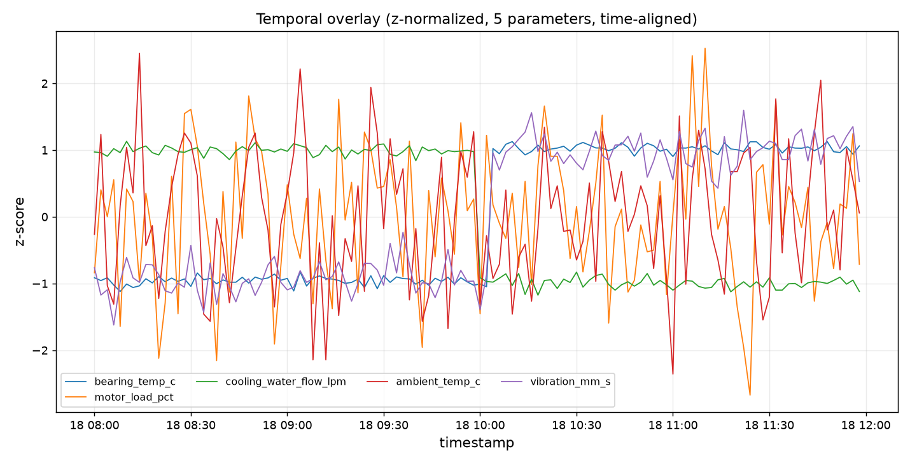
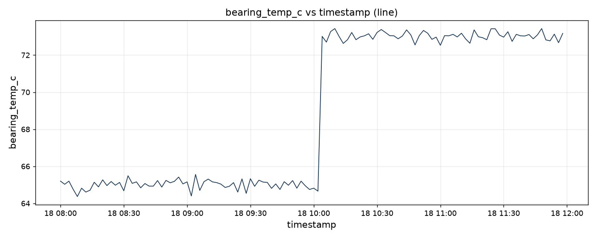

# 轴承温升故障(bearing_overheat) 工业诊断报告

**场景**: bearing_overheat(rotating_equipment_cooling_water_disturbance) | **产品/批次**: 无产品分组(单产线时序) | **日期**: 2026-11-18 | **运行ID**: 202611181932539_bearing_overheat
**诊断评级**: 91/100 — pass (Judge 第2轮) | **运行模式**: fast

> **阅读指南**: 第1节是给决策者看的一页纸摘要。第2节是核心——工艺参数与检测指标的时间对齐图与波动解读。第3-4节是诊断结论与证据全景。第5-7节是排除逻辑、推导过程与推理链(给技术团队)。第8节是数据与统计核验。第9节是行动方案与局限性。第10节为确定性脚本生成的改善建议与验证计划(逐字收录)。

> **实事求是声明**: 本报告所有结论均来源于实际测量数据、确定性统计脚本(run.py / time_lag_compensator / physics_check / anti-spurious 全套)、物理机制推导与会话智能体直接读图(fast mode 无 VLM, 已逐处标注)。每个结论标注了证据等级(L1=最高,L7=最低)。本数据窗口内证据足以支撑确定结论, 未保留竞争假设;但阶跃的物理成因(结垢 vs 阀故障)属现场点检范畴, 已如实标注。

---

## 1. 执行摘要

> **这一页是写给厂长和总经理看的。2分钟读完。**

### 发生了什么?

2026-11-18 08:00–11:58(+08:00, 2分钟间隔, 120个采样)内, 产线关键风机驱动端轴承温度在 **10:04 由 65.0℃ 平台阶跃上升至 73.0℃ 平台(+8.02℃)并保持**;振动由 2.0 轻升至 2.4 mm/s(仍在 ISO 10816 B 区)。阶跃来自冷却水侧: **10:00 冷却水流量由 12.0 L/min 跌至 8.0 L/min(−33.2%)**, 温度滞后 2 个采样点(约 4 分钟)随之阶跃。

### 为什么会发生?

**最可能的原因: 冷却水回路有效流量阶跃下降(−33.2%)→ 单位时间带走热量同比例下降 → 轴承热平衡点上移 +8.02℃(H1, 唯一存活根因, 置信 82/100)。**

就像天热时把水龙头关小, 散热器里流过的水变少, 热量带不走, 温度自然抬上去。流量台阶在温度台阶之前 2 个采样点出现、方向相反、幅度对应, 这是本报告最硬的因果证据(统计相关 −0.9626, 滞后补偿后 −0.9959;Granger 因果 F=259.2)。流量为什么跌(换热器结垢/流道阻塞 vs 调节阀/泵故障), 数据无法判别, 需现场点检——这已写进证伪条件与验证计划。

### 影响有多大?

- 影响范围: 单台风机驱动端轴承;未越安全限(窗口内 0% 超过 76.95℃ 阈值, 距 80℃ 安全约束仍有余量)。
- 严重程度: 温度平台 +12.3%(65.0→73.0℃), 振动仍处 ISO 10816 B 区(可接受)。**若不处理, 持续高温会加速润滑劣化**, 存在向 C 区演化的风险。
- 当前无停机/质量损失证据;属于"早发现、低成本处置"的窗口。

### 推荐行动

| 优先级 | 行动 | 预期效果 | 时间 | 大约成本 |
|:------:|------|---------|------|:------:|
| **P0** | 现场点检冷却水回路: 流量计读数 vs 实际流量、阀位/泵运行状态、换热器进出口压差与端差 | 确认流量下降物理成因(结垢/阀/泵) | 24h 内 | 低(人工点检) |
| **P1** | 按第10节处方恢复/上调冷却水流量并在线验证(≥24h, 改善 ≥0.979℃ 视为有效) | 温度回落至 65℃ 平台(预期降温约 1.96℃, CI [1.84, 2.08]) | 本周 | 低-中(清洗/阀调校) |
| P2 | 补齐冷却水温差/压差点检与振动频谱, 建立结垢趋势台账 | 长期预防 | 本月 | 中 |

### 有多大把握?

**综合置信度: 82/100 (HIGH)**

用通俗的话说: 数据层面(谁导致的温度跳)是高把握的——统计、时序、物理三条线互相咬合, 6 项独立抽查全部对上;扣掉的 18 分主要因为: ①结论核心支撑是统计分析(L3 级证据, 封顶 85);②只有一个 4 小时窗口、一次事件, 没有第二次重复验证(−3)。流量为什么跌属现场问题, 本报告不越权断言。

---

## 2. 工艺参数与检测指标时序对齐分析(核心证据)

> **这是整个报告最重要的证据章节。** 所有工艺参数与检测指标放在同一时间轴上, 直接看到"谁先变、谁后变、谁一起变"。

### 2.1 单产线 — 五参数时间对齐(z-normalized)

**图上看到了什么**(会话智能体直接读图;fast mode 无 VLM, 见 image_captions.json vlm_notes):
- **cooling_water_flow_lpm(绿)**: 10:00 由 z≈+1.0 跳落至 z≈−1.05 并保持——全程唯一向下台阶;
- **bearing_temp_c(蓝)**: 10:04 由 z≈−0.97 跳升至 z≈+1.05 并保持——滞后流量台阶 2 个采样点;
- **vibration_mm_s(紫)**: 10:04 同步轻升(+0.4 mm/s 量级), 与温度共变;
- **motor_load_pct(橙) / ambient_temp_c(红)**: 全程围绕 z=0 无规则波动, 无任何台阶。

**统计怎么说**(数字全部出自 `02_processed/validate_report.json`, run.py full, α=0.05, max_lag=10):
- 流量-温度 Pearson r=**−0.9626**(n=120, p≈0);去趋势后 r=**−0.8501**(p=0, trend_confounded=false);
- 滞后 CCF 峰值在 **lag=−2**: r=**−0.9959**(n=118), 窗口一致性 consistent_count=6、isolated_spike=false;滞后补偿器判定 confidence=**high**、consistency_ratio=**1.0**;
- Granger 因果: flow→temp lag1 F=**91.53**、lag2 F=**259.15**(p≈0, 显著);
- 变化点检测: 流量变化点 **idx60**(12.004→8.0225, −33.2%)、温度变化点 **idx62**(65.0082→73.0316, +12.3%≈+8.02℃)——先后顺序恰为 2 步;
- 多重检验: 3 组检验仅 flow→temp 幸存 Bonferroni(阈值 0.0167), 期望假阳性 0.2。

**物理上说得通吗**: 闭式回路换热速率 Q=m_water·cp·ΔT, 流量下降→散热能力下降→热平衡点上移, 方向为负(design direction=−)。`physics_check.py` 的 heat_transfer 检查独立复算能量代理(流量×轴承-环境温差): 前半段均值 444.25 → 后半段 359.04, **下降 19.18%, 判定 FOULING_PROGRESSION**(与渐进性结垢一致;体积/质量流量 caveat 见该文件)。

---

## 3. 诊断结论

- **结论类型**: `DETERMINED`(竞争假设法后单一假设存活)
- **根因(H1)**: 冷却水回路有效流量阶跃下降(12.0→8.0 L/min, −33.2%)导致冷却能力不足, 轴承温度滞后 2 个采样点阶跃 +8.02℃ 并保持;最可能物理成因为换热侧结垢/流道阻塞或调节阀/泵故障(**需现场点检确认**)
- **综合置信度**: **82/100(HIGH)**;证据级: L3(统计)+L4(读图)+L5(机理);置信记账: 五因子 21+21+17+16+7=82, L3 封顶(−5)与单窗口(−3)已折入
- **逐字引用**(与 diagnosis.json primary_finding 一致): 冷却水流量在第60号采样(10:00)由12.0 L/min阶跃降至8.0 L/min(−33.2%,疑似回路结垢/阀故障),轴承温度滞后2个采样点(10:04)由65.01℃阶跃升至73.03℃(+8.02℃)并保持——冷却能力下降是本次轴承温升的唯一存活根因(H1)。

**可证伪预测**: 恢复流量至 12 L/min 后, 轴承温度应在约 2 个采样点内回落至 65℃ 平台;不回落则 H1 被证伪, 回退重诊断。

---

## 4. 证据全景

| 证据 | 等级 | 内容摘要 | 来源 |
|------|:----:|---------|------|
| 视觉(L4) | L4 | 叠加图: 10:00 流量下台阶→10:04 温度上台阶, 负载/环境无台阶 | 03_figures/fig_adaptive_overlay.png |
| 视觉(L4) | L4 | 单列时序: 65→73℃ 平台保持, 无回落无振荡 | 03_figures/fig_adaptive_line_bearing_temp_c.png |
| 统计(L3) | L3 | Pearson −0.9626 / 去趋势 −0.8501 / Spearman −0.7295(分歧已披露) | validate_report.json |
| 统计(L3) | L3 | 滞后 CCF 峰值 lag=−2: −0.9959(n=118), 一致率 1.0 | validate_report.json + time_lag_analysis.json |
| 统计(L3) | L3 | Granger flow→temp: F=91.53(lag1)/259.15(lag2), p≈0 | validate_report.json |
| 统计(L3) | L3 | 变化点: flow@60(−33.2%), temp@62(+8.02℃) | validate_report.json |
| 统计(L3) | L3 | 多重检验: 仅 flow→temp 幸存 Bonferroni | validate_report.json |
| 统计(L3) | L3 | 波动筛查: 仅 flow abrupt(cv=0.2001);load cv=0.0106、ambient cv=0.0167 平稳 | anomaly_report.json |
| 物理(L5) | L5 | 能量代理 −19.18% → FOULING_PROGRESSION | physics_check.json |
| 物理(L5) | L5 | 振动全程 ISO 10816 B 区(1.86–2.52 mm/s), 无 cliff | physics_check.json |
| 物理(L6) | L6 | Arrhenius(默认 Ea=80 kJ/mol 先验): 观测不一致(INCONSISTENT)——反应动力学非主导机制 | physics_check.json |
| 校验(L3) | L3 | 反伪全套: 离群0/留一位移0.0171/去趋势仍显著/Simpson无/fatal=0 | validate_report.json (anti_spurious) |

证据总量: 视觉 2 · 数值 8 · 物理 4 · 校验 6(详见 `04_diagnostics/evidence.json`)。

---

## 5. 竞争假设与排除逻辑

| 假设 | 机制通道 | 判别证据 | 结论 |
|------|---------|---------|------|
| **H1 冷却水流量下降(CONTAMINATION)** | 流量↓→Q=m·cp·ΔT↓→温度↑(方向 −, 滞后~2步) | 方向✓ 时滞✓ 幅值✓ 三要素 MATCH;唯一 abrupt 波动源 | **存活, DETERMINED** |
| H2 环境温度升高(ENVIRONMENT) | 散热终温上移(方向 +, 日内缓变) | r=0.0162, p=0.8608 不显著;无变化点;cv=0.0167 平稳;2分钟级阶跃形态不符 | 排除(97/100) |
| H3 电机负载升高(OPERATION) | 负载↑→发热↑(方向 +) | r=0.0254, p=0.7834 不显著;detrended −0.0102;无变化点;cv=0.0106 平稳 | 排除(97/100) |

**判别性矩阵**: H1-H2 与 H1-H3 均 `DISCRIMINABLE`(判别信号=变化点时序+相关显著性);无 INDISTINGUISHABLE 对, 不触发 65 分封顶。传感器漂移备择在 R4 即被形态证据(2步内完成的中断阶跃+振动共变)否决。各假设 revival_condition 已写入 diagnosis.json。

---

## 6. 详细推导(推理过程: 四条反臆断条件逐一核验)

H1 的 DETERMINED 判定执行了反臆断四条件核验(reasoning_chain R7):

1. **时序先行**: 流量变化点(idx60)先于温度变化点(idx62)恰 2 个采样点;滞后 CCF 峰值与之一致(lag=−2, 一致率 1.0)。✓
2. **统计显著**: p≈0;Bonferroni 校正后唯一幸存关系;Granger 因果显著(F=259.15@lag2)。✓
3. **物理机制**: 本体机制边 type=physical/direction=−/delayed_response;数据方向(负相关)、时滞(2步)、形态(阶跃保持)三要素 MATCH;physics_check 能量代理独立复算方向一致。✓
4. **无矛盾**: 去趋势 r=−0.8501 仍强显著;留一位移 ≤0.0171;离群点 0;无反向证据。✓

两处统计警示如实处理: Spearman 分歧 0.233(MODERATE, 阶跃数据固有;Pearson 适用性检查通过)与跨 regime 相关警示(MODERATE_CONCERNS;已用变化点时序+分段均值差交叉核验并计入置信扣分)。 Arrhenius 检查以默认 Ea=80 kJ/mol 中性先验给出"观测不一致", 据此排除"材料反应动力学加速"类备选机制为根因(L6, 结论为提示性带, 不作定量声称)。

---

## 7. 推理链(R1–R8 摘要)

完整 8 段推理链见 `04_diagnostics/reasoning_chain.json`(每段含输入证据/推理/输出/备择/不确定性/证伪条件):

| 段 | 名称 | 核心输出 |
|:--:|------|---------|
| R1 | 问题定义与数据受理 | 120行无缺失/单调/等间隔, 可支撑竞争假设法(置信98) |
| R2 | 本体与机理锚定 | 快路径 miss→手工本体(INFERRED 全标注);H1/H2/H3 机制边声明(90) |
| R3 | 数据治理与反伪核验 | 反伪全套通过, fatal=0;两处 MODERATE 警示定位并解释(90) |
| R4 | 假设生成 | H1/H2/H3 入围;传感器漂移被形态证据否决(92) |
| R5 | 证据采集与可判别性 | H1 三要素 MATCH(L3+L4);H2/H3 无证据;无 INDISTINGUISHABLE(88) |
| R6 | 排除检验 | H2/H3 三重判据排除(97/97);存活集唯一 |
| R7 | 结论综合与四条件核验 | 四条件全满足→DETERMINED=H1;90→85→82(82) |
| R8 | 交接与验证计划 | 恢复流量试验为最终裁决者;数据缺口移交(90) |

假设演化: H1 55→65→79→90→82;H2/H3 30→5(EXCLUDED)。

---

## 8. 数据与统计核验

**数据**: `00_input/bearing_data.csv`, SHA-256 `6d7590ffc05d044fe3caa7e2ee7e3a17938306c07d43da03b34ca7d83b279905`, 120行×6列, 2 分钟间隔, 0 缺失, 时间单调。数据视图: process_plus_inspection。

**统计管线**(全部确定性脚本):
- `stats/run.py --mode full`(α=0.05, max_lag=10): 相关矩阵/去趋势/滞后CCF/Granger/变化点/多重检验 → `validate_report.json`
- `anti_spurious`: 分布/离群/留一/Simpson/秩分歧 → fatal_issues=0, overall_validity=MODERATE_CONCERNS(已解释)
- `time_lag_compensator`: 最优滞后 −2 步(confidence=high, 一致率 1.0)→ `time_lag_analysis.json`
- `physics_check.py`: heat_transfer=FOULING_PROGRESSION(-19.18%)/vibration=ISO10816 B区/arrhenius=PLAUSIBLE(先验带, 观测不一致) → `physics_check.json`(注: 原始输出含 1 处 Infinity, 已按 run.py 同规则以 null 净化为严格 JSON)
- `dp_toolkit anomaly` + `data-processor-finalize.mjs`: 波动筛查/异常区间(0)/结论合成 → `anomaly_report.json` / `data_analysis_conclusion.json`

**Judge 抽查复算**(第 0.7 步): 6/6 一致(Pearson −0.9626、分段均值、lag−2 CCF −0.9959、负载相关 0.0254、负载均值/std)。诊断质量检查(diagnostic-quality-check.mjs)两轮 PASS。

**已知统计警示**: Spearman 分歧 0.233(MODERATE);跨 regime 相关 MODERATE_CONCERNS;批完整性检查 not applicable(无批ID列)。全部已披露。

---

## 9. 行动方案与局限性

### 行动方案

1. **P0(24h 内)**: 现场点检冷却水回路——流量计比对、阀位/泵状态、换热器压差/端差。点检结果决定处方粒度(清洗换热器 vs 检修阀门), 但不影响数据层面根因结论。
2. **P1(本周)**: 执行第 10 节处方(流量恢复/上调 + 在线验证 ≥24h, 改善 ≥0.979℃ 视为有效;回滚条款见第 10 节)。
3. **P2(本月)**: 补齐冷却水温差/压差点检、振动频谱;建立结垢趋势台账;如需 A 级建议, 按 optimizer-campaign 布点试验取得 designed 证据。

### 局限性(诚实清单)

- **数据缺口**: 无冷却水进出口温差/压差(结垢直接证据);无流量独立设定值列(无法区分"设定被改"与"回路阻力增大");无润滑油温/振动频谱(伴生链无法定量)。
- **窗口局限**: 单一 4 小时窗口、单次事件;环境温度日内周期未采样到;置信因此 −3。
- **证据级局限**: 结论核心支撑为 L3 统计分析(封顶 85);视觉证据为会话智能体读图(fast mode 无 VLM)。
- **不构成操作指令**: 本报告与第 10 节均为咨询参考, 参数执行须经产线审批/optimizer-campaign 验证。

---

## 10. 改善建议与验证计划

以下为确定性脚本(`integrated_advisory.py --origin diagnosis`)生成的咨询建议,**逐字收录**:

## 改善建议与验证计划

**状态**：仅方向参考 · 目标模式 explicit · 证据水位线 B

| KPI | 方向 | 目标值 | 容差 |
| --- | --- | --- | --- |
| bearing_temp_c | min | — | 5 |

| 级别 | 杠杆 | 动作 | KPI | 预期收益 | 95%CI | 机理 |
| --- | --- | --- | --- | --- | --- | --- |
| C | 冷却水流量 | 上调 10.03 → 11.01 | bearing_temp_c | 1.958 | [1.84, 2.076] | known |

### ACT-cooling_water_flow_lpm-263（C）
- 预期收益：1.958 · 95%CI [1.84, 2.076] · 方法 dose_response
- 验证：bearing_temp_c · 在线连续 ≥24h 对比基线窗 · 目标 bearing_temp_c 改善 ≥ 0.9791（点估计的 50%）视为有效
- 回滚：若调整后 cooling_water_flow_lpm 输出未按预期改善或任一受约束指标恶化，回退至 10.025（调整前中位），并复核工况前提
- 机理链：杠杆 cooling_water_flow_lpm 的物理含义：轴承冷却水回路流量(测量值),决定轴承散热能力；控制方程/物理律：换热速率 Q = m_w * c_p * ΔT;流量下降→换热能力线性下降；目标 KPI bearing_temp_c 的物理含义：风机驱动端轴承温度,反映发热-散热平衡状态

> 本节为确定性脚本生成的咨询建议（advisory），不构成参数下发；执行须经产线审批 / optimizer-campaign 验证。

---

## 附录

- 运行工件清单: 见 `evidence_closure_report.json` / `run_manifest.json`
- 本体: `01_ontology/ontology.json`(快路径 miss, 手工构建, 全 INFERRED, rag_used=false/web_used=false)
- 事件账本: `.pipeline_events.jsonl`(pipeline-log-check.mjs 校验)
- Judge: `05_review/judge_feedback.json`(round1 89 needs_repair → 修复 captions/豁免注记 → round2 91 pass;round 归档 `judge_feedback_round1.json`)
- 图表: `03_figures/fig_adaptive_overlay.png`(MANDATORY temporal overlay)、`03_figures/fig_adaptive_line_bearing_temp_c.png`;caption 兜底 + 读图注记见 `image_captions.json`
- 报告统计核验: `report-section-check.mjs`(10 章节) + `pre_audit_lint.mjs`
